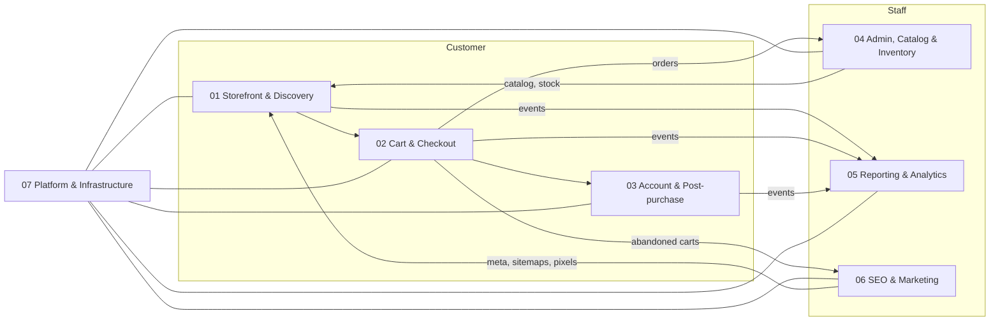

# 00 — Product Overview

## 1. Vision

Jofak is a mobile-first online store that lets a single Ghanaian retailer sell directly to consumers with the payment, delivery and communication habits customers already have: **mobile money first**, phone numbers over email, WhatsApp/SMS updates, and delivery described by landmarks and GhanaPost GPS codes rather than street addresses alone.

The platform must give the business owner a complete back office — catalog, inventory, orders, fulfilment, discounts — and the data to grow: sales, funnel, AOV, CLV, abandonment and inventory turnover, plus SEO and marketing tooling to acquire and win back customers.

## 2. Business goals

| Goal                    | Metric                                            | Launch target (indicative)       |
| ----------------------- | ------------------------------------------------- | -------------------------------- |
| Convert mobile visitors | Session → order conversion rate                   | ≥ 1.5 %                          |
| Make paying easy        | Payment success rate (initiated → successful)     | ≥ 85 %                           |
| Grow basket size        | Average Order Value (AOV)                         | Track baseline, +10 % in 6 mo    |
| Retain customers        | Repeat purchase rate within 90 days               | ≥ 20 %                           |
| Recover lost revenue    | Abandoned-cart recovery rate                      | ≥ 8 %                            |
| Keep stock healthy      | Inventory turnover; stock-out rate on top 50 SKUs | Stock-out < 5 %                  |
| Be found organically    | Organic sessions share; indexed product pages     | 100 % of active products indexed |
| Be fast on 3G/4G        | LCP p75 on mobile                                 | < 2.5 s                          |

## 3. Personas

### Customers

| Persona                       | Description                                                               | Key needs                                                        |
| ----------------------------- | ------------------------------------------------------------------------- | ---------------------------------------------------------------- |
| **Ama — mobile shopper**      | 26, Accra, shops on an Android phone over mobile data, pays with MTN MoMo | Fast pages, MoMo checkout, WhatsApp updates, clear delivery fees |
| **Kwame — returning buyer**   | 38, Kumasi, buys regularly, wants reorder and tracking                    | Saved addresses, order history, fast reorder, loyalty perks      |
| **Efua — gift buyer / guest** | Buys once for someone else, doesn't want an account                       | Guest checkout, deliver-to-other-person, gift note               |
| **Diaspora buyer**            | Lives abroad, pays by card for delivery to family in Ghana                | Card payments, recipient phone number, clear delivery ETA        |

### Staff

| Persona                    | Role key          | Key needs                                                   |
| -------------------------- | ----------------- | ----------------------------------------------------------- |
| **Owner**                  | `owner`           | Dashboards, full control, staff management, settings        |
| **Store admin**            | `admin`           | Everything except billing/ownership transfer                |
| **Catalog manager**        | `catalog_manager` | Products, categories, pricing, media, SEO fields            |
| **Inventory / fulfilment** | `fulfilment`      | Pick/pack lists, stock adjustments, rider assignment        |
| **Customer support**       | `support`         | Look up customers and orders, cancellations, returns, notes |
| **Marketer**               | `marketing`       | Discounts, campaigns, abandoned-cart flows, pixels, reports |

## 4. Key assumptions

- **Single vendor.** One business owns all inventory. No seller onboarding, payouts or commissions.
- **Currency:** Ghana cedi (GHS) only at launch. Prices are **tax-inclusive** on the storefront.
- **Payments:** Paystack as the primary gateway (MTN MoMo, Telecel Cash, AirtelTigo/AT Money, Visa/Mastercard, bank transfer). Hubtel is the documented alternative. Cash/MoMo on delivery (COD) is configurable per delivery zone.
- **Tax:** VAT and statutory levies (NHIL, GETFund; COVID-19 levy if still applicable) configured as rates in admin, not hard-coded. Rates and applicability must be confirmed with the business's accountant against current GRA rules.
- **Delivery:** zone-based fees (e.g. Accra Central, Greater Accra outskirts, Kumasi, other regional capitals, rest of Ghana) plus store pickup. In-house riders and/or third-party couriers.
- **Identity:** phone number (E.164, `+233…`) is the primary customer identifier; email is optional but encouraged.
- **Notifications:** SMS (e.g. Hubtel/Arkesel/mNotify), WhatsApp Business API, email (transactional provider).
- **Language:** English at launch; copy kept in translation files so Twi/French can be added.
- **Regulation:** Ghana Data Protection Act, 2012 (Act 843) — consent, access, correction and deletion rights; Electronic Transactions Act, 2008 (Act 772).

## 5. Scope map

## 6. Roadmap

### MVP (public launch)

- Storefront: home, categories, product listing with filters, product page with variants, basic search
- Guest and customer cart; coupon codes; zone-based delivery; tax-inclusive pricing
- Paystack checkout (MoMo + card) with webhooks; optional COD
- Customer accounts with phone OTP; address book; order history and status tracking
- Admin: products/variants/media, categories, inventory with stock ledger, orders & fulfilment, basic discounts, staff roles
- Analytics: sales dashboard, AOV, conversion funnel, cart abandonment rate, low-stock report
- SEO: slugs, meta tags with fallbacks, canonical URLs, XML sitemaps, robots.txt, Product/Breadcrumb JSON-LD
- Marketing: abandoned-cart reminder (1-step SMS/email), Meta Pixel + GA4 with consent

### Phase 2

- Reviews & ratings (submit + moderate), wishlist, recently viewed
- Returns/RMA and partial refunds
- Search autocomplete and typo tolerance; related products
- CLV, cohort retention, inventory turnover reports; scheduled report emails
- Multi-step abandoned-cart flows incl. WhatsApp; auto-generated recovery coupons
- Server-side conversion APIs (Meta CAPI, GA4 Measurement Protocol), TikTok pixel
- Bulk CSV import/export; CMS content blocks; redirects manager

### Phase 3

- Loyalty points / referral program
- "Frequently bought together" and personalised recommendations
- Predictive CLV and demand forecasting / reorder suggestions
- Multi-location inventory with transfers
- Additional currencies (e.g. NGN, USD for diaspora) and languages
- Native mobile app / PWA offline cart

## 7. Non-goals (for now)

- Marketplace / multi-vendor features
- B2B wholesale pricing, quotes, credit terms
- Subscriptions and recurring billing
- Physical POS integration
- Cross-border shipping outside Ghana

## 8. Open questions

1. Final list of delivery zones, fees and ETAs; which zones allow COD?
2. Which levies apply to the business's VAT scheme (standard vs flat rate) — affects tax display and invoices.
3. In-house riders, third-party couriers, or both? Any courier APIs to integrate?
4. Preferred SMS and WhatsApp providers (cost per message affects recovery-flow design).
5. Do we need VAT invoices (with TIN) generated per order at launch?
