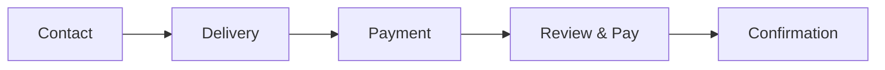
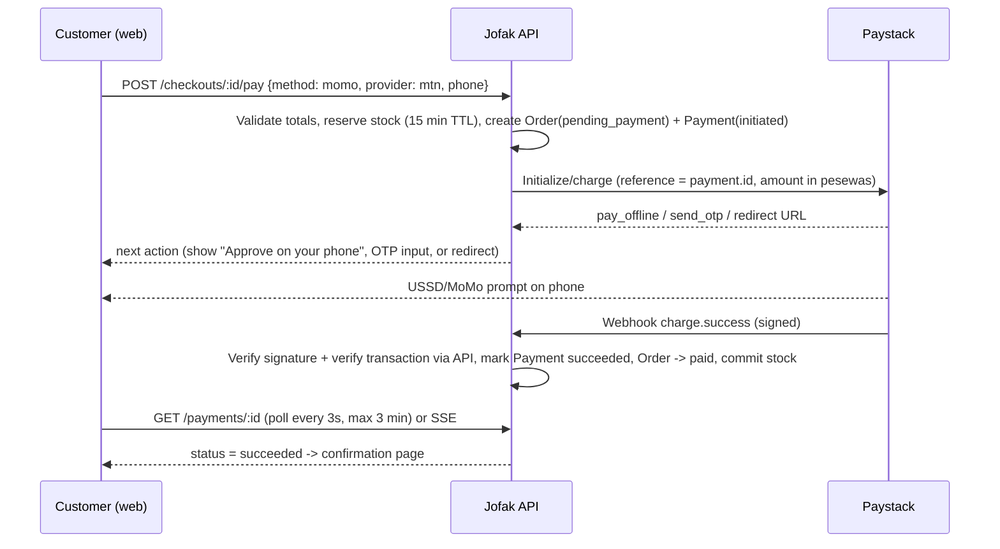
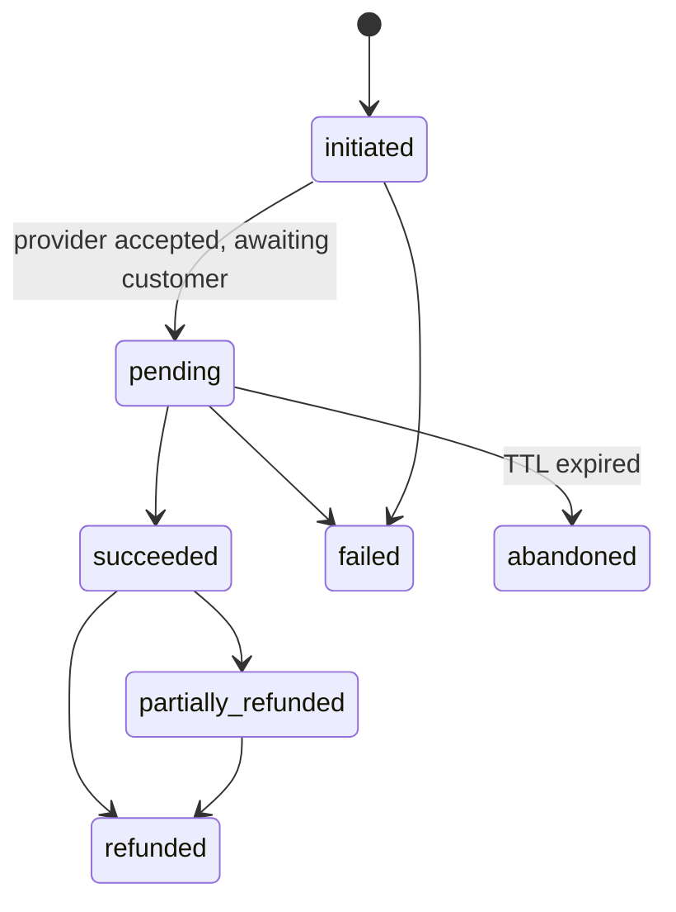
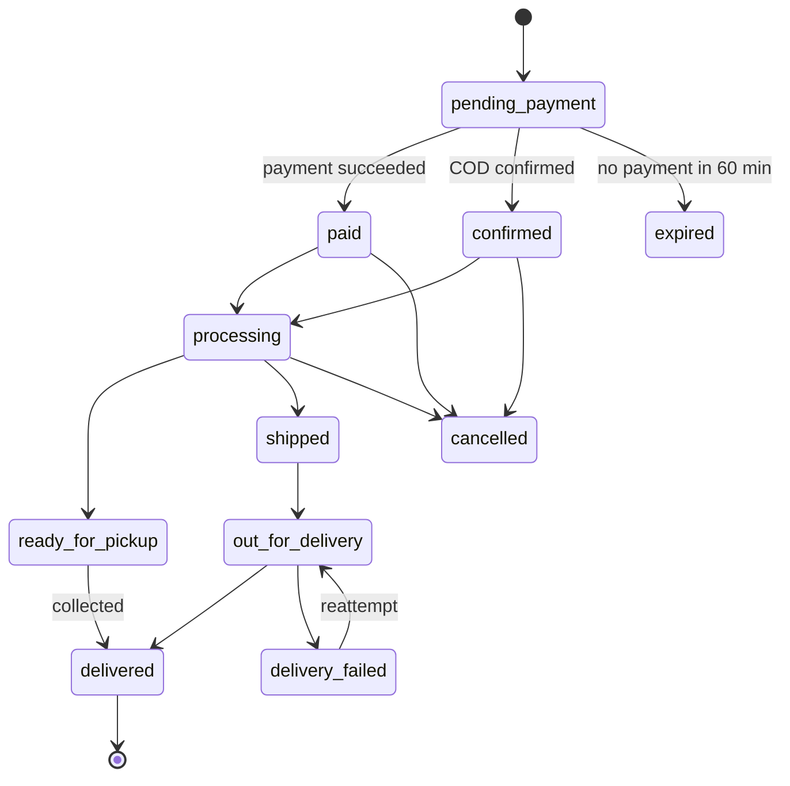

# 02 — Shopping Cart & Checkout

## 1. Summary & goals

Cart and checkout turn intent into paid orders. In Ghana that means **mobile money as the default payment path**, phone-number-first contact details, landmark-friendly addresses, transparent delivery fees and graceful handling of the asynchronous, sometimes slow, MoMo approval prompt.

**Success metrics**

| Metric                          | Definition                                        | Target  |
| ------------------------------- | ------------------------------------------------- | ------- |
| Cart → checkout start           | Sessions starting checkout / sessions with a cart | ≥ 45 %  |
| Checkout completion             | Orders placed / checkouts started                 | ≥ 55 %  |
| Payment success rate            | Successful payments / payment attempts            | ≥ 85 %  |
| Time to complete checkout (p50) | From checkout start to order placed               | < 2 min |
| Oversell incidents              | Orders accepted for stock that did not exist      | 0       |

## 2. Personas

Ama (MoMo, mobile), Kwame (saved address, returning), Efua (guest, gift), Diaspora buyer (card, recipient differs from payer). Support staff handle failed payments.

## 3. Sub-features

### 3.1 Cart — `MVP`

| ID        | Requirement                                                                                                                                                             |
| --------- | ----------------------------------------------------------------------------------------------------------------------------------------------------------------------- |
| CHK-FR-01 | Guests get a cart identified by an opaque `cartToken` (httpOnly cookie, 30-day expiry). Logged-in customers have one active cart bound to `customerId`.                 |
| CHK-FR-02 | Add, update quantity, remove line; each line references a `variantId`. Duplicate adds increment quantity.                                                               |
| CHK-FR-03 | Quantity is validated against `available` stock and `maxPerOrder`; requests over the limit are clamped with a message, not rejected.                                    |
| CHK-FR-04 | Prices are **always recalculated server-side** from current variant prices and active promotions on every cart read; the client never sends prices.                     |
| CHK-FR-05 | When a line's price or availability changed since it was added, the cart response includes `notices[]` (e.g. `PRICE_CHANGED`, `OUT_OF_STOCK`, `QTY_REDUCED`).           |
| CHK-FR-06 | Cart merge on login: guest cart lines are merged into the customer cart (sum quantities, clamp to stock); the guest cart is then marked `merged`.                       |
| CHK-FR-07 | Mini-cart drawer and full cart page show line items, subtotal, discount, estimated delivery (if zone known), tax-inclusive note and total.                              |
| CHK-FR-08 | "Save for later" moves a line to wishlist — `Phase 2`.                                                                                                                  |
| CHK-FR-09 | Cart activity (`lastActivityAt`) is tracked for abandoned-cart detection ([06 §3.6](./06-seo-marketing.md#36-abandoned-cart-recovery--mvp-1-step--phase-2-multi-step)). |

**Business rules**

- Max 50 distinct lines and max quantity 99 per line.
- Carts are not stock reservations. Stock is reserved only when payment is initiated (3.6).
- Guest carts inactive for 30 days are purged; customer carts are kept.

**Edge cases**: product archived while in cart → line flagged `UNAVAILABLE` and excluded from totals; two tabs editing the same cart → last write wins with version check (`cart.version`), stale client refetches.

### 3.2 Discounts, coupons & promotions — `MVP` (codes) / `Phase 2` (automatic & advanced)

| ID        | Requirement                                                                                                                                                           | Phase   |
| --------- | --------------------------------------------------------------------------------------------------------------------------------------------------------------------- | ------- |
| CHK-FR-10 | Apply one coupon code per cart. Types: percentage off order, fixed amount off order, free delivery.                                                                   | MVP     |
| CHK-FR-11 | Conditions: min subtotal, specific products/categories/collections, first order only, customer segment, start/end dates, total usage limit, per-customer usage limit. | MVP     |
| CHK-FR-12 | Invalid codes return a specific reason: `NOT_FOUND`, `EXPIRED`, `MIN_SUBTOTAL_NOT_MET`, `USAGE_LIMIT_REACHED`, `NOT_ELIGIBLE`.                                        | MVP     |
| CHK-FR-13 | Automatic promotions (no code): "Buy 2 get 1 free", tiered "Spend GHS 500, get 10 % off", bundle prices.                                                              | Phase 2 |
| CHK-FR-14 | Stacking rules: automatic promotions may stack with one code if both are flagged `combinable`.                                                                        | Phase 2 |
| CHK-FR-15 | Single-use generated codes (for abandoned-cart recovery, apologies, referrals).                                                                                       | Phase 2 |

**Business rules**: Discounts apply to the tax-inclusive price; discount allocation is distributed proportionally across eligible lines (needed for partial refunds). Usage counts are incremented only when the order is **paid** (or confirmed for COD), and re-checked atomically at that point.

### 3.3 Checkout flow — `MVP`

Single-page, step-wise checkout optimised for mobile:

| ID        | Requirement                                                                                                                                                                                                                                                     |
| --------- | --------------------------------------------------------------------------------------------------------------------------------------------------------------------------------------------------------------------------------------------------------------- |
| CHK-FR-16 | **Contact**: phone number (required, Ghana numbers validated & normalised to E.164 `+233XXXXXXXXX`; international allowed for diaspora payer), name, email (optional; required for card payments if the gateway needs it). Guests may tick "Create an account". |
| CHK-FR-17 | Logged-in customers skip Contact; defaults pre-filled from profile and default address.                                                                                                                                                                         |
| CHK-FR-18 | **Recipient**: "Delivering to someone else?" toggle captures recipient name and phone.                                                                                                                                                                          |
| CHK-FR-19 | **Gift options** — `Phase 2`: gift note, hide prices on packing slip.                                                                                                                                                                                           |
| CHK-FR-20 | A `Checkout` record snapshots cart, contact, address, delivery method, discount and totals; each step PATCHes it.                                                                                                                                               |
| CHK-FR-21 | Totals are recomputed on every step and shown with a breakdown: subtotal, discount, delivery, total; "Includes VAT & levies of GHS X".                                                                                                                          |
| CHK-FR-22 | Emits `checkout_started`, `delivery_info_added`, `payment_info_added` analytics events (funnel steps).                                                                                                                                                          |

### 3.4 Delivery options & fees — `MVP`

**Address model (Ghana)**

| Field           | Required | Notes                                                      |
| --------------- | -------- | ---------------------------------------------------------- |
| `region`        | yes      | One of Ghana's 16 regions (select)                         |
| `city`          | yes      | Town/city (select within region, free text fallback)       |
| `area`          | yes      | Neighbourhood / suburb (e.g. East Legon)                   |
| `streetAddress` | no       | House number / street if known                             |
| `landmark`      | yes      | "Near Shell filling station, opposite the blue gate"       |
| `ghanaPostGps`  | no       | Digital address, format `XX-XXX-XXXX` (validated by regex) |
| `geo`           | no       | lat/lng from "Use my location" (browser geolocation)       |
| `contactPhone`  | yes      | Recipient phone                                            |

**Delivery methods**

| ID        | Requirement                                                                                                                                             |
| --------- | ------------------------------------------------------------------------------------------------------------------------------------------------------- |
| CHK-FR-23 | Delivery zones map (region, city, area) → zone. Each zone defines methods with fee, ETA range, cut-off time and COD eligibility.                        |
| CHK-FR-24 | Fee rules: flat per zone, optional weight surcharge per kg above threshold, free delivery over a subtotal threshold per zone.                           |
| CHK-FR-25 | Methods: **Standard delivery**, **Express / same-day** (if before cut-off, e.g. 12:00 in Accra), **Store pickup** (pickup locations with hours, fee 0). |
| CHK-FR-26 | ETA displayed as dates, accounting for cut-off, Sundays and configured public holidays (e.g. Independence Day, Christmas).                              |
| CHK-FR-27 | Address outside any zone → "We don't deliver here yet" + pickup offered; option to leave phone number to be notified — `Phase 2`.                       |

### 3.5 Tax — `MVP`

| ID        | Requirement                                                                                                                                                                                  |
| --------- | -------------------------------------------------------------------------------------------------------------------------------------------------------------------------------------------- |
| CHK-FR-28 | Catalog prices are tax-inclusive. Tax is extracted for display and accounting: `taxAmount = gross − gross / (1 + combinedRate)`.                                                             |
| CHK-FR-29 | Tax configuration is a list of named components (e.g. VAT, NHIL, GETFund) with rates, effective dates and whether they compound. Order lines store a snapshot of the components and amounts. |
| CHK-FR-30 | Products can belong to a tax class (`standard`, `exempt`, `zero_rated`) to support exempt items.                                                                                             |
| CHK-FR-31 | Delivery fee taxability is configurable.                                                                                                                                                     |

Rates are configuration, never code. Business/accountant confirms the applicable scheme before launch.

### 3.6 Payments — `MVP`

**Supported methods (via Paystack)**: MTN Mobile Money, Telecel Cash, AT Money, Visa/Mastercard, bank transfer (Phase 2), Pay on delivery (cash or MoMo to the delivery partner, who remits to the store; zone-dependent).

| ID        | Requirement                                                                                                                                                                                     |
| --------- | ----------------------------------------------------------------------------------------------------------------------------------------------------------------------------------------------- |
| CHK-FR-32 | Payment is implemented behind a `PaymentProvider` interface (`initialize`, `submitOtp`, `verify`, `refund`, `parseWebhook`) so Hubtel or others can be added.                                   |
| CHK-FR-33 | MoMo flow: customer enters wallet number + network (auto-detected from prefix, editable). UI shows "Approve the prompt on your phone" with countdown and a "Resend prompt" action after 60 s.   |
| CHK-FR-34 | Card flow: Paystack inline/redirect (3-D Secure handled by gateway). Jofak never sees or stores card numbers (PCI scope SAQ A).                                                                 |
| CHK-FR-35 | Webhooks are the source of truth. Signature (`x-paystack-signature`, HMAC-SHA512) is verified; the transaction is re-verified via the provider's verify API before state change.                |
| CHK-FR-36 | Idempotency: webhook events are stored with provider event ID; reprocessing a seen event is a no-op. Client `POST /pay` requires an `Idempotency-Key` header.                                   |
| CHK-FR-37 | Amount and currency in the webhook must equal the order total; mismatches flag the order for manual review.                                                                                     |
| CHK-FR-38 | Reconciliation job every 10 min verifies payments stuck in `initiated`/`pending` > 15 min with the provider.                                                                                    |
| CHK-FR-39 | Failed/abandoned payment: stock reservation released at TTL; customer may retry with same or different method (new `Payment` on same `Order`) until the order expires (60 min).                 |
| CHK-FR-40 | Pay on delivery: order goes to `confirmed` (unpaid) immediately; optional SMS OTP verification of the phone number before confirmation to reduce fake orders; max COD order value configurable. |

**Payment state machine**

### 3.7 Order creation — `MVP`

| ID        | Requirement                                                                                                                                                                                                                                                     |
| --------- | --------------------------------------------------------------------------------------------------------------------------------------------------------------------------------------------------------------------------------------------------------------- |
| CHK-FR-41 | Order is created at payment initiation with status `pending_payment`, human-friendly number (`JFK-250001`), and immutable snapshots of line items (name, SKU, options, unit price, discount allocation, tax components), addresses, delivery method and totals. |
| CHK-FR-42 | Stock: reserve on initiation (`reserved += qty`), commit on payment success (`onHand -= qty; reserved -= qty`), release on failure/expiry. All via the stock ledger (see [04 §3.5](./04-admin-catalog-inventory.md#35-inventory--mvp)).                         |
| CHK-FR-43 | Reservation uses row-level locking / atomic conditional update (`UPDATE … SET reserved = reserved + :q WHERE available >= :q`) to prevent overselling.                                                                                                          |
| CHK-FR-44 | On success: cart marked `converted`, coupon usage incremented, `OrderPlaced` + `OrderPaid` events emitted, confirmation SMS + email (with order number, items, total, delivery ETA, tracking link) sent.                                                        |
| CHK-FR-45 | Guest orders get a signed tracking link (`/orders/track?token=…`) and can be claimed by creating an account with the same phone number.                                                                                                                         |

**Order state machine** (fulfilment states continue in [04](./04-admin-catalog-inventory.md#36-order-management--fulfilment--mvp))

### 3.8 Confirmation page — `MVP`

Shows order number, status, items, totals, delivery ETA, payment method, "Track order" and "Continue shopping"; for guests a one-tap "Save your details — create account" (password-less via OTP). Fires `purchase` analytics/pixel event exactly once (deduplicated by order ID).

## 4. Data entities

| Entity               | Key fields                                                                                                                                                                                           |
| -------------------- | ---------------------------------------------------------------------------------------------------------------------------------------------------------------------------------------------------- |
| `Cart`               | id, token, customerId?, status (`active`/`merged`/`converted`/`abandoned`), currency, couponCode, version, lastActivityAt, recoveredFromCampaignId?                                                  |
| `CartItem`           | id, cartId, variantId, quantity, addedAt, unitPriceAtAdd                                                                                                                                             |
| `Checkout`           | id, cartId, contact{}, recipient{}, shippingAddress{}, deliveryMethodId, pickupLocationId, totals{}, status, expiresAt                                                                               |
| `Discount`           | id, code?, type, value, conditions{}, combinable, usageLimit, perCustomerLimit, usedCount, startsAt, endsAt, isActive                                                                                |
| `DiscountRedemption` | discountId, orderId, customerId, amount                                                                                                                                                              |
| `DeliveryZone`       | id, name, areas[] (region/city/area), isActive                                                                                                                                                       |
| `DeliveryMethod`     | id, zoneId, type (`standard`/`express`/`pickup`), fee, freeOver, weightRule{}, etaMinDays, etaMaxDays, cutoffTime, codAllowed                                                                        |
| `PickupLocation`     | id, name, address{}, hours{}, isActive                                                                                                                                                               |
| `TaxComponent`       | id, name, rate, compound, effectiveFrom, effectiveTo                                                                                                                                                 |
| `Order`              | id, number, customerId?, guestPhone, status, currency, subtotal, discountTotal, deliveryFee, taxTotal, total, contact{}, shippingAddress{}, deliveryMethodSnapshot{}, placedAt, paidAt, source/utm{} |
| `OrderItem`          | id, orderId, variantId, productSnapshot{}, quantity, unitPrice, discountAllocated, taxComponents[], lineTotal                                                                                        |
| `Payment`            | id, orderId, provider, method, providerReference, amount, status, failureReason, rawResponse, createdAt                                                                                              |
| `PaymentEvent`       | id, provider, providerEventId (unique), type, payload, processedAt                                                                                                                                   |
| `StockReservation`   | id, orderId, variantId, quantity, expiresAt, status                                                                                                                                                  |

## 5. API endpoints

Modules: `cart`, `checkout`, `payments`, `orders`, `delivery`, `discounts`.

| Method & path                                   | Auth                  | Purpose                                         |
| ----------------------------------------------- | --------------------- | ----------------------------------------------- |
| `GET /api/cart`                                 | guest\|customer       | Current cart with recalculated totals & notices |
| `POST /api/cart/items`                          | guest\|customer       | Add `{variantId, quantity}`                     |
| `PATCH /api/cart/items/:itemId`                 | guest\|customer       | Update quantity                                 |
| `DELETE /api/cart/items/:itemId`                | guest\|customer       | Remove line                                     |
| `POST /api/cart/coupon`                         | guest\|customer       | Apply code                                      |
| `DELETE /api/cart/coupon`                       | guest\|customer       | Remove code                                     |
| `POST /api/cart/merge`                          | customer              | Merge guest cart (called after login)           |
| `GET /api/delivery/zones`                       | public                | Regions/cities/areas → zones                    |
| `GET /api/delivery/methods?region=&city=&area=` | public                | Available methods with fee & ETA for cart       |
| `GET /api/pickup-locations`                     | public                | Pickup points                                   |
| `POST /api/checkouts`                           | guest\|customer       | Create checkout from cart                       |
| `PATCH /api/checkouts/:id`                      | guest\|customer       | Update contact/address/method                   |
| `GET /api/checkouts/:id`                        | guest\|customer       | Checkout with totals                            |
| `POST /api/checkouts/:id/pay`                   | guest\|customer       | Initiate payment (Idempotency-Key)              |
| `POST /api/payments/:id/otp`                    | guest\|customer       | Submit OTP/PIN step if requested                |
| `GET /api/payments/:id`                         | guest\|customer       | Poll status                                     |
| `POST /api/webhooks/paystack`                   | signature             | Provider webhook                                |
| `GET /api/orders/:number/confirmation`          | guest token\|customer | Confirmation data                               |

## 6. Domain events

| Event                             | Emitted when                | Consumers                                                                       |
| --------------------------------- | --------------------------- | ------------------------------------------------------------------------------- |
| `CartItemAdded`                   | Line added                  | Analytics (`add_to_cart`), pixels                                               |
| `CartItemRemoved`                 | Line removed                | Analytics                                                                       |
| `CheckoutStarted`                 | Checkout created            | Analytics funnel, pixels (`InitiateCheckout`), abandonment                      |
| `PaymentInitiated`                | Pay called                  | Analytics, reservation timer                                                    |
| `PaymentSucceeded`                | Verified success            | Orders, inventory commit, notifications                                         |
| `PaymentFailed`                   | Provider failure            | Notifications (retry link), analytics                                           |
| `OrderPlaced`                     | Order paid or COD confirmed | Fulfilment, analytics, pixels (`Purchase`), marketing (stop recovery flow), CLV |
| `OrderExpired`                    | Unpaid after TTL            | Inventory release, abandonment flow                                             |
| `StockReserved` / `StockReleased` | Reservation changes         | Inventory, storefront revalidation                                              |

## 7. UI surfaces

| Route                          | Page                   |
| ------------------------------ | ---------------------- |
| (drawer)                       | Mini-cart              |
| `/cart`                        | Cart                   |
| `/checkout`                    | Checkout (steps)       |
| `/checkout/pay/[paymentId]`    | Awaiting MoMo approval |
| `/checkout/success/[number]`   | Confirmation           |
| `/checkout/failed/[paymentId]` | Payment failed / retry |

## 8. Acceptance criteria (MVP)

- **Given** a guest adds an item and later logs in with an existing cart, **when** login completes, **then** both carts' lines are merged and quantities are clamped to stock.
- **Given** a variant has 1 unit available and two customers initiate payment simultaneously, **when** both requests reserve stock, **then** exactly one succeeds and the other receives `OUT_OF_STOCK`.
- **Given** a MoMo payment is initiated, **when** Paystack sends `charge.success` twice, **then** the order is marked paid once, one confirmation SMS is sent and stock is committed once.
- **Given** a webhook with an invalid signature, **when** received, **then** it is rejected with 401 and no state changes.
- **Given** a payment stays pending for 15 minutes, **when** the reconciliation job runs, **then** it queries the provider and updates the payment to its true status.
- **Given** a coupon with `minSubtotal = GHS 200`, **when** applied to a GHS 150 cart, **then** the API returns `MIN_SUBTOTAL_NOT_MET` and the remaining amount is shown.
- **Given** the shopper's area is in a zone with `freeOver = GHS 500`, **when** subtotal after discount ≥ GHS 500, **then** delivery is GHS 0.00.
- **Given** an order total of GHS 240.00 and combined tax rate configured, **when** the order is created, **then** each line stores tax components and the sum equals `taxTotal` (rounding difference assigned to the last line).

## 9. Open questions

1. Final cut-off time for same-day delivery and which zones offer it?
2. Is phone OTP required for COD orders, or only above a value threshold?
3. Should we support split payment (part MoMo, part card)? (Assumed no.)
4. Do we need "Pay with Paystack link via WhatsApp" for orders taken by support staff?
