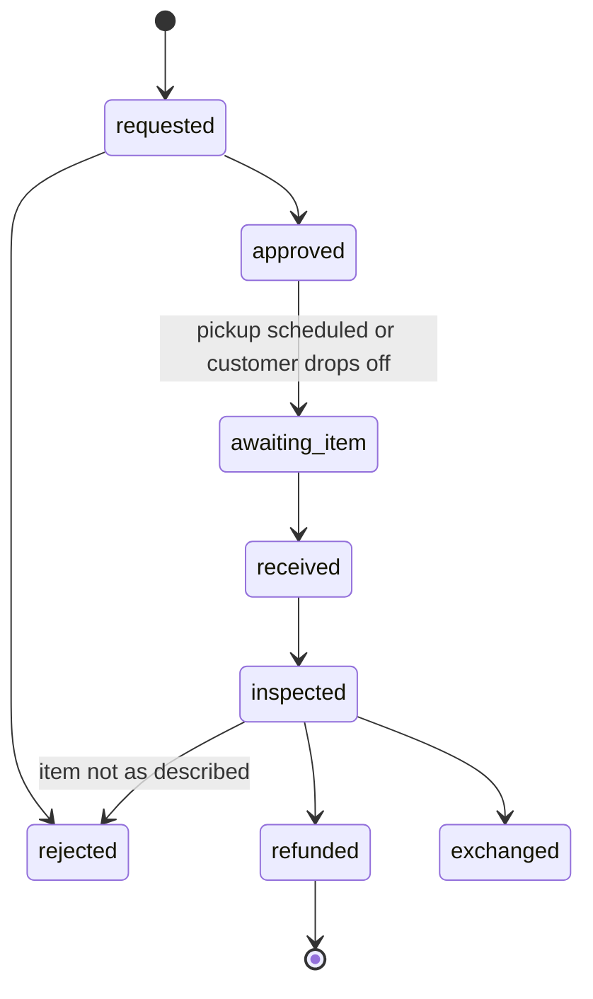

# 03 — Customer Account & Post-Purchase

## 1. Summary & goals

Accounts let customers check out faster, track orders, manage returns and hear from us on their own terms. Post-purchase is where trust is built: clear status updates over SMS/WhatsApp, easy cancellations, a fair returns process and prompt refunds to the original MoMo wallet or card.

**Success metrics**

| Metric                            | Definition                                       | Target   |
| --------------------------------- | ------------------------------------------------ | -------- |
| Account creation rate at checkout | Guest checkouts that create an account           | ≥ 25 %   |
| "Where is my order?" contacts     | Support tickets about order status / orders      | < 5 %    |
| Refund turnaround (p90)           | Return approved → refund completed               | < 3 days |
| Repeat purchase rate (90 days)    | Customers with ≥ 2 orders in 90 days / customers | ≥ 20 %   |
| OTP delivery success              | OTPs verified / OTPs sent                        | ≥ 90 %   |

## 2. Personas

Kwame (returning), Ama (mobile, prefers WhatsApp), Efua (guest who may convert), Support staff.

## 3. Sub-features

### 3.1 Registration & authentication — `MVP`

| ID        | Requirement                                                                                                                                                                   |
| --------- | ----------------------------------------------------------------------------------------------------------------------------------------------------------------------------- |
| ACC-FR-01 | Sign up / sign in with **phone number + OTP** (6 digits, 5-minute validity, max 5 attempts, resend after 60 s, max 5 sends per hour per number).                              |
| ACC-FR-02 | OTP delivery channel: SMS by default; WhatsApp if the customer chooses — `Phase 2`.                                                                                           |
| ACC-FR-03 | Optional **email + password** sign-in (password min 8 chars, checked against breached-password list) with email verification link.                                            |
| ACC-FR-04 | Social sign-in (Google; Apple for iOS users) — `Phase 2`. Accounts are linked by verified email.                                                                              |
| ACC-FR-05 | Sessions: short-lived access JWT (15 min) + rotating refresh token (30 days) in httpOnly, `Secure`, `SameSite=Lax` cookies. Refresh token reuse detection revokes the family. |
| ACC-FR-06 | "Sign out of all devices" revokes all refresh tokens.                                                                                                                         |
| ACC-FR-07 | Guest-to-account claim: after OTP verification, past guest orders with the same phone (and/or verified email) are linked to the account.                                      |
| ACC-FR-08 | Rate limiting and bot protection on OTP endpoints (per IP + per phone) to prevent SMS pumping fraud; block premium-rate/non-Ghana prefixes unless enabled.                    |

**Edge cases**: customer changes SIM/number → change phone flow requires OTP on both old (if available) and new number, or support-assisted verification; email already used by another account → prompt to sign in instead.

### 3.2 Profile — `MVP`

Name, phone (verified), email (verified flag), date of birth (optional, for birthday offers — `Phase 2`), gender (optional), preferred contact channel (SMS / WhatsApp / email), marketing consent per channel with timestamp and source.

### 3.3 Address book — `MVP`

| ID        | Requirement                                                                                                                                      |
| --------- | ------------------------------------------------------------------------------------------------------------------------------------------------ |
| ACC-FR-09 | CRUD addresses using the Ghana address model ([02 §3.4](./02-cart-checkout.md#34-delivery-options--fees--mvp)); label (Home, Work, Mum's place). |
| ACC-FR-10 | One default delivery address; max 10 addresses.                                                                                                  |
| ACC-FR-11 | Addresses used at checkout are saved automatically for logged-in customers (opt-out checkbox).                                                   |
| ACC-FR-12 | Address edits never change past orders (orders keep snapshots).                                                                                  |

### 3.4 Order history & detail — `MVP`

| ID        | Requirement                                                                                                                                    |
| --------- | ---------------------------------------------------------------------------------------------------------------------------------------------- |
| ACC-FR-13 | Paginated list of orders: number, date, status badge, item thumbnails, total.                                                                  |
| ACC-FR-14 | Detail: items, prices, discounts, delivery fee, tax breakdown, payment method (masked, e.g. "MTN MoMo •••• 4521"), addresses, status timeline. |
| ACC-FR-15 | **Reorder**: adds all still-available items to cart at current prices, reporting unavailable ones.                                             |
| ACC-FR-16 | Download receipt / VAT invoice PDF.                                                                                                            |
| ACC-FR-17 | "Get help with this order" opens a WhatsApp chat pre-filled with the order number, or a contact form.                                          |

### 3.5 Order tracking & notifications — `MVP`

| ID        | Requirement                                                                                                                                 |
| --------- | ------------------------------------------------------------------------------------------------------------------------------------------- |
| ACC-FR-18 | Tracking timeline mirrors order status: Placed → Paid/Confirmed → Processing → Shipped / Ready for pickup → Out for delivery → Delivered.   |
| ACC-FR-19 | When out for delivery, show rider name and phone (masked call-through optional), and courier tracking number/link if a third-party courier. |
| ACC-FR-20 | Public tracking page (`/orders/track`) works with order number + phone, or a signed token link, without login.                              |
| ACC-FR-21 | Notifications per status change via customer's preferred channel. Templates per event and channel are editable in admin.                    |
| ACC-FR-22 | Delivery confirmation: rider marks delivered (optionally with customer delivery OTP for high-value orders — `Phase 2`).                     |

**Default notification matrix**

| Event                 | SMS | WhatsApp (Phase 2) | Email |
| --------------------- | --- | ------------------ | ----- |
| Order placed          | ✓   | ✓                  | ✓     |
| Payment failed        | ✓   | ✓                  | ✓     |
| Shipped / ready       | ✓   | ✓                  | ✓     |
| Out for delivery      | ✓   | ✓                  |       |
| Delivered             |     | ✓                  | ✓     |
| Cancelled / refunded  | ✓   | ✓                  | ✓     |
| Review request (+3 d) |     | ✓                  | ✓     |

### 3.6 Cancellations — `MVP`

| ID        | Requirement                                                                                                                                            |
| --------- | ------------------------------------------------------------------------------------------------------------------------------------------------------ |
| ACC-FR-23 | Customers can self-cancel while status ∈ {`pending_payment`, `paid`, `confirmed`} and before staff start processing. Reason is required (select list). |
| ACC-FR-24 | Cancellation of a paid order triggers a full refund to the original payment method and releases/returns stock.                                         |
| ACC-FR-25 | After processing starts, customers can request cancellation; support approves or declines.                                                             |

### 3.7 Returns & refunds — `Phase 2` (MVP: support-handled refunds only)

| ID        | Requirement                                                                                                                                                          |
| --------- | -------------------------------------------------------------------------------------------------------------------------------------------------------------------- |
| ACC-FR-26 | Return request within the return window (default 7 days after delivery; configurable per category, some categories non-returnable e.g. underwear, perishables).      |
| ACC-FR-27 | Select items and quantities, reason (wrong size, damaged, not as described, changed mind), optional photos (required for "damaged").                                 |
| ACC-FR-28 | Resolution options: refund to original method, store credit (Phase 3), exchange for another variant.                                                                 |
| ACC-FR-29 | Refund amount = item price paid (after discount allocation) for returned quantity; delivery fee refunded only if the return is due to our error.                     |
| ACC-FR-30 | Refunds go through the payment provider's refund API (Paystack supports MoMo and card refunds); COD orders are refunded by MoMo transfer recorded manually by staff. |
| ACC-FR-31 | Customer is notified at each RMA state and can see status in their account.                                                                                          |

### 3.8 Reviews & ratings (submission) — `Phase 2`

| ID        | Requirement                                                                                                                       |
| --------- | --------------------------------------------------------------------------------------------------------------------------------- |
| ACC-FR-32 | Customers with a delivered order can review each purchased product once: 1–5 stars, title, body (20–2,000 chars), up to 4 photos. |
| ACC-FR-33 | Review request message sent 3 days after delivery with a deep link.                                                               |
| ACC-FR-34 | Reviews enter moderation (`pending`); profanity and PII (phone numbers) auto-flagged.                                             |
| ACC-FR-35 | Customers can edit/delete their review; edits re-enter moderation.                                                                |
| ACC-FR-36 | "Was this helpful?" votes, one per customer per review.                                                                           |

### 3.9 Notification preferences & consent — `MVP`

Transactional messages are always sent (via the preferred channel). Marketing messages require explicit opt-in per channel, recorded with timestamp, source and IP. One-click unsubscribe in every marketing email; "STOP" keyword for SMS; opt-out button for WhatsApp.

### 3.10 Privacy & data rights — `MVP`

| ID        | Requirement                                                                                                                                                                                         |
| --------- | --------------------------------------------------------------------------------------------------------------------------------------------------------------------------------------------------- |
| ACC-FR-37 | Export my data: JSON/CSV of profile, addresses, orders, reviews, consents — generated async and emailed/downloadable within 24 h.                                                                   |
| ACC-FR-38 | Delete my account: soft-delete immediately (sign-out, hide profile), anonymise PII after 30-day grace period. Orders are retained with anonymised customer data for statutory accounting retention. |
| ACC-FR-39 | Privacy policy and consent text versions are recorded against the customer.                                                                                                                         |

### 3.11 Loyalty & referrals — `Phase 3`

Points per GHS spent, redeemable at checkout; referral code giving both parties a discount after the referee's first delivered order.

## 4. Data entities

| Entity                 | Key fields                                                                                                                                                                                                        |
| ---------------------- | ----------------------------------------------------------------------------------------------------------------------------------------------------------------------------------------------------------------- |
| `Customer`             | id, phone (E.164, unique), phoneVerifiedAt, email (unique, nullable), emailVerifiedAt, passwordHash?, firstName, lastName, dob?, preferredChannel, status (`active`/`disabled`/`deleted`), createdAt, lastOrderAt |
| `AuthIdentity`         | id, customerId, provider (`phone`/`password`/`google`/`apple`), providerUserId                                                                                                                                    |
| `OtpChallenge`         | id, phone, purpose, codeHash, attempts, expiresAt, consumedAt, ip                                                                                                                                                 |
| `RefreshToken`         | id, subjectId, subjectType, familyId, tokenHash, expiresAt, revokedAt, userAgent, ip                                                                                                                              |
| `Address`              | id, customerId, label, recipientName, phone, region, city, area, streetAddress, landmark, ghanaPostGps, lat, lng, isDefault                                                                                       |
| `Consent`              | id, customerId, channel, purpose (`marketing`), granted, source, policyVersion, createdAt                                                                                                                         |
| `OrderStatusHistory`   | id, orderId, fromStatus, toStatus, actorType, actorId, note, createdAt                                                                                                                                            |
| `ReturnRequest`        | id, orderId, customerId, status, reason, resolution, items[], photos[], refundAmount, createdAt                                                                                                                   |
| `Refund`               | id, orderId, paymentId, returnRequestId?, amount, status, providerReference, reason, createdBy                                                                                                                    |
| `NotificationLog`      | id, recipient, channel, template, payloadRef, status, providerMessageId, sentAt, cost                                                                                                                             |
| `Review`, `ReviewVote` | see [01](./01-storefront-discovery.md#4-data-entities)                                                                                                                                                            |

## 5. API endpoints

Modules: `auth`, `customers`, `addresses`, `orders`, `returns`, `reviews`, `notifications`, `privacy`.

| Method & path                                                   | Auth           | Purpose                       |
| --------------------------------------------------------------- | -------------- | ----------------------------- |
| `POST /api/auth/otp/request`                                    | public         | Send OTP `{phone, purpose}`   |
| `POST /api/auth/otp/verify`                                     | public         | Verify OTP, sign in / sign up |
| `POST /api/auth/login`                                          | public         | Email + password              |
| `POST /api/auth/refresh`                                        | refresh cookie | Rotate tokens                 |
| `POST /api/auth/logout`                                         | customer       | Revoke current session        |
| `POST /api/auth/logout-all`                                     | customer       | Revoke all sessions           |
| `POST /api/auth/password/forgot` / `reset`                      | public         | Password reset                |
| `GET /api/me` / `PATCH /api/me`                                 | customer       | Profile                       |
| `POST /api/me/phone/change`                                     | customer       | Change phone (OTP)            |
| `GET /api/me/addresses` / `POST` / `PATCH /:id` / `DELETE /:id` | customer       | Address book                  |
| `GET /api/me/orders`                                            | customer       | Order list                    |
| `GET /api/me/orders/:number`                                    | customer       | Order detail                  |
| `POST /api/me/orders/:number/reorder`                           | customer       | Reorder into cart             |
| `POST /api/me/orders/:number/cancel`                            | customer       | Cancel / request cancel       |
| `GET /api/me/orders/:number/invoice`                            | customer       | Invoice PDF                   |
| `GET /api/orders/track?number=&phone=` / `?token=`              | public         | Public tracking               |
| `POST /api/me/returns` / `GET /api/me/returns`                  | customer       | Returns (Phase 2)             |
| `POST /api/me/reviews` / `PATCH /:id` / `DELETE /:id`           | customer       | Reviews (Phase 2)             |
| `POST /api/reviews/:id/helpful`                                 | customer       | Helpful vote (Phase 2)        |
| `GET /api/me/preferences` / `PATCH`                             | customer       | Channels & consents           |
| `POST /api/me/data-export`                                      | customer       | Request export                |
| `DELETE /api/me`                                                | customer       | Delete account                |
| `GET /api/unsubscribe?token=`                                   | signed token   | One-click unsubscribe         |

## 6. Domain events

| Event                                     | Emitted when                 | Consumers                                         |
| ----------------------------------------- | ---------------------------- | ------------------------------------------------- |
| `CustomerRegistered`                      | First successful OTP/sign-up | Analytics, marketing (welcome flow)               |
| `CustomerLoggedIn`                        | Sign-in                      | Cart merge, analytics                             |
| `OrderStatusChanged`                      | Any status transition        | Notifications, analytics                          |
| `OrderCancelled`                          | Cancel                       | Payments (refund), inventory (restock), analytics |
| `ReturnRequested` / `ReturnStatusChanged` | RMA updates                  | Support queue, notifications                      |
| `RefundIssued`                            | Refund succeeded             | Analytics (net revenue), notifications            |
| `ReviewSubmitted`                         | Review created               | Moderation queue                                  |
| `ConsentChanged`                          | Opt-in/out                   | Marketing audiences, pixel audiences              |
| `CustomerDeleted`                         | Anonymisation complete       | All PII holders (search index, ESP, CRM)          |

## 7. UI surfaces

| Route                      | Page                                   |
| -------------------------- | -------------------------------------- |
| `/account/login`           | Phone/OTP, email/password              |
| `/account`                 | Dashboard (recent orders, quick links) |
| `/account/profile`         | Profile & security                     |
| `/account/addresses`       | Address book                           |
| `/account/orders`          | Orders list                            |
| `/account/orders/[number]` | Order detail & tracking                |
| `/account/returns`         | Returns (Phase 2)                      |
| `/account/reviews`         | My reviews (Phase 2)                   |
| `/account/preferences`     | Notifications & privacy                |
| `/orders/track`            | Public tracking                        |

## 8. Acceptance criteria (MVP)

- **Given** a new phone number, **when** the customer verifies the OTP, **then** an account is created, they are signed in, and their guest cart is merged.
- **Given** 5 OTP requests for one number within an hour, **when** a 6th is requested, **then** the API returns 429 with `retryAfter`.
- **Given** a guest who placed two orders with `+233241234567`, **when** they create an account with that number, **then** both orders appear in their order history.
- **Given** a paid order not yet processing, **when** the customer cancels with a reason, **then** the order becomes `cancelled`, a full refund is initiated, stock is restored and an SMS confirms it.
- **Given** an order moves to `out_for_delivery`, **when** the status changes, **then** an SMS with the rider's contact and tracking link is sent within 1 minute.
- **Given** a customer requests account deletion, **when** 30 days pass, **then** PII is anonymised, orders remain with anonymised customer reference, and the customer cannot sign in.

## 9. Open questions

1. Return window length and non-returnable categories?
2. Will riders use an app/PWA to update status, or will fulfilment staff update on their behalf?
3. Store credit: needed for returns at launch, or refunds only?
4. Is a VAT invoice with the business TIN required on every order?
