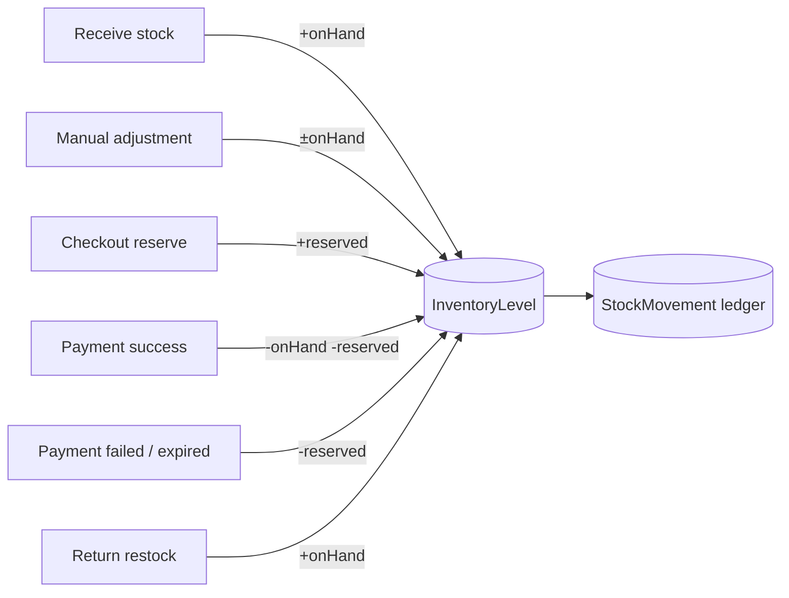

# 04 — Admin, Catalog & Inventory Management

## 1. Summary & goals

The admin console (`/admin` in `apps/web`, backed by `/api/admin/*`) is where staff run the store: products and pricing, stock, orders and fulfilment, customers, discounts, content, settings and staff. It must be safe (role-based, audited), efficient for daily repetitive work (bulk actions, keyboard-friendly tables) and usable on a tablet in the stockroom.

**Success metrics**

| Metric                        | Definition                                    | Target  |
| ----------------------------- | --------------------------------------------- | ------- |
| Time to publish a new product | Create → active, single variant with 4 images | < 5 min |
| Order processing time (p50)   | Paid → shipped / ready for pickup             | < 24 h  |
| Stock accuracy                | Cycle-count matches system / counted SKUs     | ≥ 98 %  |
| Unauthorised-action incidents | Actions outside role permissions              | 0       |

## 2. Personas

Owner, Store admin, Catalog manager, Fulfilment, Support, Marketing (see [Overview §3](./00-overview.md#3-personas)).

## 3. Sub-features

### 3.1 Staff, roles & permissions (RBAC) — `MVP`

| ID        | Requirement                                                                                                                                                                                        |
| --------- | -------------------------------------------------------------------------------------------------------------------------------------------------------------------------------------------------- |
| ADM-FR-01 | Staff accounts are separate from customer accounts (`StaffUser`), invited by email, sign in with email + password + **mandatory TOTP 2FA** (authenticator app).                                    |
| ADM-FR-02 | Permissions are granular strings (`products:write`, `orders:refund`, `inventory:adjust`, `reports:view`, `settings:write`, `staff:manage`, …). Roles bundle permissions; custom roles — `Phase 2`. |
| ADM-FR-03 | Guards on every `/api/admin/*` route check permissions (NestJS `@RequirePermissions()` decorator + guard).                                                                                         |
| ADM-FR-04 | Owner role cannot be removed from the last owner; ownership transfer requires 2FA re-confirmation.                                                                                                 |
| ADM-FR-05 | Session timeout after 12 h; idle timeout 60 min; staff can see and revoke their active sessions.                                                                                                   |

**Default role → permission matrix**

| Permission group                   | owner | admin | catalog_manager |  fulfilment   |   support   | marketing |
| ---------------------------------- | :---: | :---: | :-------------: | :-----------: | :---------: | :-------: |
| Products & categories              |  RW   |  RW   |       RW        |       R       |      R      |     R     |
| Pricing                            |  RW   |  RW   |       RW        |       –       |      R      |     R     |
| Inventory adjust                   |  RW   |  RW   |        R        |      RW       |      R      |     –     |
| Orders view                        |   ✓   |   ✓   |        –        |       ✓       |      ✓      |     ✓     |
| Orders fulfil                      |   ✓   |   ✓   |        –        |       ✓       |      –      |     –     |
| Orders cancel/refund               |   ✓   |   ✓   |        –        |       –       | ✓ (≤ limit) |     –     |
| Customers                          |  RW   |  RW   |        –        |       R       |     RW      |     R     |
| Discounts & campaigns              |  RW   |  RW   |        –        |       –       |      R      |    RW     |
| Content / SEO                      |  RW   |  RW   |       RW        |       –       |      –      |    RW     |
| Reports                            |   ✓   |   ✓   |   ✓ (catalog)   | ✓ (inventory) |      –      |     ✓     |
| Settings (payments, tax, delivery) |  RW   |  RW   |        –        |       –       |      –      |     –     |
| Staff management                   |  RW   |   R   |        –        |       –       |      –      |     –     |

### 3.2 Product management — `MVP`

| ID        | Requirement                                                                                                                                                                                                                            |
| --------- | -------------------------------------------------------------------------------------------------------------------------------------------------------------------------------------------------------------------------------------- |
| ADM-FR-06 | Create/edit products: name, rich-text description, brand, primary + additional categories, tags, attributes (key/value for specs and filters), tax class, status (`draft`, `active`, `archived`), publish date (scheduled publishing). |
| ADM-FR-07 | Options & variants: up to 3 options (e.g. Size, Colour, Material) generating a variant matrix; per variant: SKU (unique), barcode, price, compare-at price, cost price (for margin/turnover reports), weight, stock, image.            |
| ADM-FR-08 | Bulk edit variants (set price for all, increase by %).                                                                                                                                                                                 |
| ADM-FR-09 | Media: drag-and-drop upload (JPEG/PNG/WebP, ≤ 10 MB), reorder, alt text, assign to variants. Images are stored in object storage and transformed on the fly (resize, WebP/AVIF).                                                       |
| ADM-FR-10 | SEO panel per product: slug, meta title, meta description, OG image, preview of search snippet ([06](./06-seo-marketing.md)).                                                                                                          |
| ADM-FR-11 | Validation before activation: ≥ 1 image, price > 0, SKU set, primary category set, description present.                                                                                                                                |
| ADM-FR-12 | Duplicate product; archive (hidden, URL handled per SEO rules); hard delete only for never-ordered drafts.                                                                                                                             |
| ADM-FR-13 | Product list: search by name/SKU, filter by status, category, stock status, brand; sort; bulk actions (publish, archive, add tag, set category).                                                                                       |
| ADM-FR-14 | Revision history: who changed what (price, status, stock) — via audit log (3.10).                                                                                                                                                      |

**Business rules**: Changing SKU of an ordered variant is allowed but logged; order items keep their snapshot. Price changes take effect immediately for carts (recalculated) but never alter existing orders.

### 3.3 Bulk import / export — `Phase 2`

CSV/XLSX import of products and variants with a template, dry-run validation report (row-level errors), upsert by SKU, async processing with progress, and export of the filtered product list. Images imported by URL.

### 3.4 Categories, collections & brands — `MVP`

Drag-and-drop tree editor for categories (max depth 3), with name, slug, description, banner, SEO fields and active toggle. Collections: manual (pick & order products) or rule-based (conditions from [01 §3.2](./01-storefront-discovery.md#32-category-tree--collections--mvp)). Brands: name, slug, logo.

### 3.5 Inventory — `MVP`

| ID        | Requirement                                                                                                                                                   |
| --------- | ------------------------------------------------------------------------------------------------------------------------------------------------------------- |
| ADM-FR-15 | Inventory tracked per variant per location. MVP: one location (main warehouse/shop). Multi-location & transfers — `Phase 3`.                                  |
| ADM-FR-16 | `available = onHand − reserved`. Never negative unless the variant allows back-orders.                                                                        |
| ADM-FR-17 | Every change writes an immutable `StockMovement` (type, quantity delta, before/after, reference to order/return/adjustment, actor, reason).                   |
| ADM-FR-18 | Adjustments require a reason: `received`, `count_correction`, `damaged`, `lost`, `returned`, `other` (note).                                                  |
| ADM-FR-19 | Receive stock flow: select variants (or scan barcode), quantities, optional supplier and unit cost (updates weighted average cost).                           |
| ADM-FR-20 | Low-stock threshold per variant (default global, e.g. 5). Crossing it emits `StockLow` → daily digest email and dashboard alert; reaching 0 emits `StockOut`. |
| ADM-FR-21 | Stock counts / cycle counts — `Phase 2`: generate a count sheet, enter counted quantities, review variances, apply as `count_correction` movements.           |
| ADM-FR-22 | "Track inventory" can be disabled per variant (e.g. made-to-order items).                                                                                     |
| ADM-FR-23 | Back-in-stock notifications to subscribers when `available` goes from 0 to > 0 — `Phase 2`.                                                                   |
| ADM-FR-24 | Suppliers & purchase orders — `Phase 3`; reorder suggestions from sales velocity — `Phase 3`.                                                                 |

### 3.6 Order management & fulfilment — `MVP`

| ID        | Requirement                                                                                                                                                                                                                                                                                                                                      |
| --------- | ------------------------------------------------------------------------------------------------------------------------------------------------------------------------------------------------------------------------------------------------------------------------------------------------------------------------------------------------ |
| ADM-FR-25 | Order list with filters (status, payment status, delivery method/zone, date range, COD, flagged), search (number, phone, name, email), saved views ("To pack", "Out for delivery", "COD to collect").                                                                                                                                            |
| ADM-FR-26 | Order detail: customer, items, payments & refunds, timeline (status history, notifications sent, staff notes), addresses with map link (GhanaPost GPS / coordinates), risk flags.                                                                                                                                                                |
| ADM-FR-27 | Fulfilment workflow: `paid/confirmed` → **Start processing** → print pick list & packing slip → **Mark packed** → for delivery: hand over to the external delivery partner (optional tracking no.) → **Out for delivery** → **Delivered** / **Delivery failed** (reason, reattempt date). Pickup: **Ready for pickup** (SMS with pickup code) → **Collected** (verify code). |
| ADM-FR-28 | Bulk actions: print pick lists for selected orders, move to processing, mark packed.                                                                                                                                                                                                                                                            |
| ADM-FR-29 | Partial fulfilment (split shipment) — `Phase 2`.                                                                                                                                                                                                                                                                                                 |
| ADM-FR-30 | Edit order before processing: change address/delivery method, remove items (with partial refund); add items — `Phase 2`.                                                                                                                                                                                                                         |
| ADM-FR-31 | Cancel order with reason; refund full or partial amount to original payment method; restock toggle per item.                                                                                                                                                                                                                                     |
| ADM-FR-32 | COD reconciliation: cash/MoMo collected by the delivery partner per day, mark as remitted; mismatches flagged.                                                                                                                                                                                                                                   |
| ADM-FR-33 | Manual / phone orders: staff create an order for a customer and send a Paystack payment link via SMS/WhatsApp — `Phase 2`.                                                                                                                                                                                                                       |
| ADM-FR-34 | ~~Riders: list of riders and rider view~~ — **out of scope** (2026-11-15): delivery is handled outside the application. Staff update delivery status from the delivery partner's confirmation.                                                                                                                                                  |
| ADM-FR-35 | Fraud/risk flags: COD order > threshold, many failed payments, mismatched amounts, repeat failed deliveries for the same phone.                                                                                                                                                                                                                  |

### 3.7 Returns, refunds & disputes — `MVP` (refunds) / `Phase 2` (RMA)

Return requests queue (approve, reject, schedule pickup, receive, inspect, resolve — see [03 §3.7](./03-customer-account.md#37-returns--refunds--phase-2-mvp-support-handled-refunds-only)); refund dialog with line-level amounts and reason; refunds above a configurable amount require `admin`. Chargebacks/disputes from Paystack shown on the order with evidence upload — `Phase 2`.

### 3.8 Customer management — `MVP`

Customer list (search, filter by orders count, total spent, last order, consent), profile with orders, addresses, lifetime value, notes and tags (e.g. `VIP`, `wholesale-interest`), disable account, resend verification, trigger data export/deletion on request. PII views are audit-logged.

### 3.9 Discounts & promotions — `MVP`

CRUD for coupon codes and (Phase 2) automatic promotions with all conditions from [02 §3.2](./02-cart-checkout.md#32-discounts-coupons--promotions--mvp-codes--phase-2-automatic--advanced); bulk-generate unique codes; performance per discount (uses, revenue, discount cost).

### 3.10 Content (CMS), settings & audit — `MVP`

| ID        | Requirement                                                                                                                                                                                                                                                                                                                            |
| --------- | -------------------------------------------------------------------------------------------------------------------------------------------------------------------------------------------------------------------------------------------------------------------------------------------------------------------------------------- |
| ADM-FR-36 | Content blocks for home page and landing pages ([01 §3.1](./01-storefront-discovery.md#31-home-page--merchandising--mvp)); static pages (About, FAQ, Delivery, Returns, Privacy, Terms) with rich text and SEO fields.                                                                                                                 |
| ADM-FR-37 | Navigation menus (header, footer) editor.                                                                                                                                                                                                                                                                                              |
| ADM-FR-38 | Settings: store profile (name, logo, contact, WhatsApp number, TIN), currency/format, tax components, delivery zones & methods & pickup locations, holidays, payment providers (keys stored encrypted; test/live mode), notification providers & templates, checkout options (COD, guest checkout, OTP for COD), SEO defaults, pixels. |
| ADM-FR-39 | Audit log: every admin write (actor, action, entity, before/after diff, IP, timestamp), filterable, read-only, retained 2 years.                                                                                                                                                                                                       |
| ADM-FR-40 | Admin dashboard home: today's sales, orders to process, low-stock alerts, pending returns, failed payments (links into lists).                                                                                                                                                                                                         |

## 4. Data entities

| Entity           | Key fields                                                                                                                    |
| ---------------- | ----------------------------------------------------------------------------------------------------------------------------- |
| `StaffUser`      | id, email, name, passwordHash, totpSecret (encrypted), roleId, status, lastLoginAt                                            |
| `Role`           | id, name, permissions[], isSystem                                                                                             |
| `Location`       | id, name, address{}, isDefault                                                                                                |
| `InventoryLevel` | variantId, locationId, onHand, reserved, lowStockThreshold, trackInventory, allowBackorder, avgCost                           |
| `StockMovement`  | id, variantId, locationId, type, delta, onHandBefore, onHandAfter, referenceType, referenceId, reason, actorId, createdAt     |
| `Supplier`       | id, name, contact{} (Phase 3)                                                                                                 |
| `Fulfilment`     | id, orderId, items[], method, courier?, trackingNumber?, status, packedAt, dispatchedAt, deliveredAt, failureReason           |
| `CodRemittance`  | id, courier, date, expectedAmount, collectedAmount, status                                                                    |
| `OrderNote`      | id, orderId, staffId, body, isCustomerVisible                                                                                 |
| `Page`           | id, slug, title, body, seo{}, status                                                                                          |
| `Menu`           | id, key (`header`/`footer`), items[]                                                                                          |
| `Setting`        | key, value (JSON), updatedBy                                                                                                  |
| `AuditLog`       | id, actorType, actorId, action, entityType, entityId, diff, ip, userAgent, createdAt                                          |

## 5. API endpoints

All under `/api/admin`, authenticated as staff with the listed permission.

| Method & path                                             | Permission            | Purpose                       |
| --------------------------------------------------------- | --------------------- | ----------------------------- |
| `POST /api/admin/auth/login` / `POST /api/admin/auth/2fa` | public                | Staff sign-in + TOTP          |
| `GET/POST /api/admin/staff`, `PATCH/DELETE /:id`          | `staff:manage`        | Staff & invites               |
| `GET/POST /api/admin/roles`, `PATCH /:id`                 | `staff:manage`        | Roles (custom: Phase 2)       |
| `GET/POST /api/admin/products`                            | `products:read/write` | List / create                 |
| `GET/PATCH/DELETE /api/admin/products/:id`                | `products:*`          | Detail / update / delete      |
| `POST /api/admin/products/:id/duplicate`                  | `products:write`      | Duplicate                     |
| `POST /api/admin/products/bulk`                           | `products:write`      | Bulk actions                  |
| `PUT /api/admin/products/:id/variants`                    | `products:write`      | Upsert variant matrix         |
| `POST /api/admin/media/uploads`                           | `products:write`      | Get signed upload URL         |
| `POST /api/admin/imports` / `GET /:id`                    | `products:write`      | Bulk import (Phase 2)         |
| `GET /api/admin/exports/products`                         | `products:read`       | Export (Phase 2)              |
| `GET/POST/PATCH/DELETE /api/admin/categories[/:id]`       | `products:write`      | Categories                    |
| `PUT /api/admin/categories/tree`                          | `products:write`      | Reorder tree                  |
| `GET/POST/PATCH/DELETE /api/admin/collections[/:id]`      | `products:write`      | Collections                   |
| `GET/POST/PATCH /api/admin/brands[/:id]`                  | `products:write`      | Brands                        |
| `GET /api/admin/inventory`                                | `inventory:read`      | Levels with filters           |
| `POST /api/admin/inventory/adjustments`                   | `inventory:adjust`    | Adjust / receive stock        |
| `GET /api/admin/inventory/movements`                      | `inventory:read`      | Ledger                        |
| `POST /api/admin/inventory/counts` / `PATCH /:id`         | `inventory:adjust`    | Stock counts (Phase 2)        |
| `GET /api/admin/orders`                                   | `orders:read`         | List                          |
| `GET /api/admin/orders/:id`                               | `orders:read`         | Detail                        |
| `POST /api/admin/orders/:id/status`                       | `orders:fulfil`       | Transition status             |
| `POST /api/admin/orders/:id/fulfilments`                  | `orders:fulfil`       | Create/assign fulfilment      |
| `POST /api/admin/orders/:id/cancel`                       | `orders:cancel`       | Cancel                        |
| `POST /api/admin/orders/:id/refunds`                      | `orders:refund`       | Refund                        |
| `POST /api/admin/orders/:id/notes`                        | `orders:read`         | Add note                      |
| `GET /api/admin/orders/pick-list?ids=`                    | `orders:fulfil`       | Pick list / packing slips PDF |
| `GET/POST /api/admin/cod-remittances`                     | `orders:fulfil`       | COD reconciliation            |
| `GET /api/admin/returns`, `POST /:id/transition`          | `orders:refund`       | RMA queue (Phase 2)           |
| `GET /api/admin/customers`, `GET/PATCH /:id`              | `customers:*`         | Customers                     |
| `GET/POST/PATCH/DELETE /api/admin/discounts[/:id]`        | `discounts:write`     | Discounts                     |
| `POST /api/admin/discounts/:id/codes`                     | `discounts:write`     | Bulk-generate codes           |
| `GET/PATCH /api/admin/reviews[/:id]`                      | `content:write`       | Moderate reviews (Phase 2)    |
| `GET/POST/PATCH/DELETE /api/admin/pages[/:id]`            | `content:write`       | Static pages                  |
| `GET/PUT /api/admin/content-blocks`                       | `content:write`       | Home/landing blocks           |
| `GET/PUT /api/admin/menus/:key`                           | `content:write`       | Menus                         |
| `GET/PATCH /api/admin/settings/:group`                    | `settings:write`      | Settings groups               |
| `GET/POST/PATCH /api/admin/delivery/zones[/:id]`          | `settings:write`      | Zones & methods               |
| `GET /api/admin/audit-logs`                               | `staff:manage`        | Audit log                     |
| `GET /api/admin/dashboard`                                | `reports:view`        | Dashboard summary             |

## 6. Domain events

| Event                                                     | Emitted when          | Consumers                                                           |
| --------------------------------------------------------- | --------------------- | ------------------------------------------------------------------- |
| `ProductPublished` / `ProductUpdated` / `ProductArchived` | Catalog changes       | Storefront revalidation, search index, sitemap, pixels catalog feed |
| `PriceChanged`                                            | Variant price changed | Wishlist price-drop alerts, analytics                               |
| `InventoryChanged`                                        | Any stock movement    | Storefront availability, search index                               |
| `StockLow` / `StockOut` / `BackInStock`                   | Threshold crossings   | Staff alerts, back-in-stock notifications                           |
| `OrderStatusChanged`                                      | Fulfilment transition | Customer notifications, analytics                                   |
| `FulfilmentDispatched`                                    | Out for delivery      | SMS "on its way" (+ tracking link if any)                          |
| `RefundIssued`                                            | Refund succeeded      | Analytics, notifications                                            |
| `CategoryUpdated`                                         | Tree/slug changes     | Redirects, sitemap, navigation cache                                |
| `SettingsChanged`                                         | Settings update       | Config cache invalidation                                           |

## 7. UI surfaces

`/admin` (dashboard), `/admin/products`, `/admin/products/[id]`, `/admin/categories`, `/admin/collections`, `/admin/inventory`, `/admin/inventory/movements`, `/admin/orders`, `/admin/orders/[id]`, `/admin/returns`, `/admin/customers`, `/admin/customers/[id]`, `/admin/discounts`, `/admin/content`, `/admin/pages`, `/admin/reports/*` ([05](./05-analytics-reporting.md)), `/admin/marketing/*` ([06](./06-seo-marketing.md)), `/admin/settings/*`, `/admin/staff`, `/admin/audit-log`.

The admin may live in `apps/web` under a route group with its own layout, or as a separate `apps/admin` Next.js app sharing `@repo/ui` — see [Platform §2](./07-platform-infrastructure.md#2-target-architecture).

## 8. Acceptance criteria (MVP)

- **Given** a staff user with role `support`, **when** they call `POST /api/admin/inventory/adjustments`, **then** the API returns 403 and the attempt is audit-logged.
- **Given** a product missing images, **when** a catalog manager sets status `active`, **then** activation is blocked with validation errors listing missing fields.
- **Given** a stock adjustment of −3 with reason `damaged`, **when** saved, **then** `onHand` decreases by 3 and a `StockMovement` records before/after values and the actor.
- **Given** a variant's available stock drops from 6 to 4 with threshold 5, **when** the movement is committed, **then** `StockLow` is emitted once and the variant appears in the low-stock list.
- **Given** a paid order, **when** fulfilment marks it `out_for_delivery` (handed to the delivery partner), **then** the customer receives an "on its way" SMS and the timeline shows the transition with the staff member.
- **Given** a partial refund of GHS 50 on a MoMo-paid order, **when** submitted, **then** a Paystack refund is created, the order shows `partially_refunded` payment status and net revenue reports reflect −GHS 50.

## 9. Open questions

1. Separate admin app vs route group in `apps/web`? (Recommendation in Platform doc.)
2. Do we need barcode label printing at launch?
3. Refund approval threshold for support staff?
4. Is the shop also a physical store needing "in-store" stock separate from online stock?
