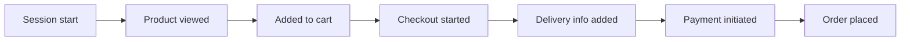
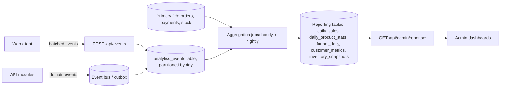

# 05 — Reporting & Analytics

## 1. Summary & goals

Give the owner and staff trustworthy numbers to run the business: how much we sold, where shoppers drop off, how valuable customers are, how much revenue is lost in abandoned carts and how fast stock turns. Every metric has **one written definition** (this document) so dashboards, exports and ad-hoc queries agree.

Two data sources feed reporting:

1. **Transactional data** (orders, payments, refunds, stock movements) from the primary database — the source of truth for money and stock.
2. **Behavioural events** (page/product views, add-to-cart, checkout steps) captured first-party — the source for funnels and abandonment.

**Success metrics**

| Metric                    | Target                                                               |
| ------------------------- | -------------------------------------------------------------------- |
| Dashboard load time (p95) | < 2 s for a 90-day range                                             |
| Data freshness            | Sales: ≤ 5 min; funnel/behaviour: ≤ 1 h; cohort/CLV: daily           |
| Revenue reconciliation    | Dashboard net revenue = sum of paid orders − refunds (to the pesewa) |

## 2. Personas

Owner (all), Admin, Marketing (funnel, campaigns, abandonment, CLV), Catalog manager (product performance), Fulfilment (inventory reports).

## 3. Metric definitions

All money in GHS, tax-inclusive unless stated. Time zone: `Africa/Accra` (UTC+0). An order "counts" on its `placedAt` date once it reaches `paid` (or `confirmed` for COD) and is not `expired`.

| Metric                        | Formula / definition                                                                                                                                                                                               |
| ----------------------------- | ------------------------------------------------------------------------------------------------------------------------------------------------------------------------------------------------------------------ |
| **Gross sales**               | Σ (unit price × qty) of counted orders, before discounts                                                                                                                                                           |
| **Discounts**                 | Σ discount amounts on counted orders                                                                                                                                                                               |
| **Refunds / returns**         | Σ refunds issued in the period (attributed to the refund date)                                                                                                                                                     |
| **Net sales**                 | Gross sales − discounts − refunds                                                                                                                                                                                  |
| **Delivery revenue**          | Σ delivery fees charged                                                                                                                                                                                            |
| **Tax collected**             | Σ tax components (VAT, NHIL, GETFund…)                                                                                                                                                                             |
| **Total revenue**             | Net sales + delivery revenue                                                                                                                                                                                       |
| **Net revenue (ex-tax)**      | Total revenue − tax collected                                                                                                                                                                                      |
| **Orders**                    | Count of counted orders                                                                                                                                                                                            |
| **Units sold**                | Σ quantities on counted orders                                                                                                                                                                                     |
| **AOV — Average Order Value** | (Gross sales − discounts + delivery revenue) / orders, i.e. the average order total at placement; refunds are excluded so AOV is not distorted by refund timing. Also shown _excluding delivery_ as "AOV (items)". |
| **Gross margin**              | Net sales ex-tax − COGS, where COGS = Σ (variant avgCost at sale time × qty)                                                                                                                                       |
| **Conversion rate**           | Sessions with ≥ 1 counted order / total sessions                                                                                                                                                                   |
| **Cart abandonment rate**     | 1 − (carts converted to orders / carts created with ≥ 1 item) within the period                                                                                                                                    |
| **Checkout abandonment rate** | 1 − (orders placed / checkouts started)                                                                                                                                                                            |
| **Payment success rate**      | Successful payments / payment attempts (by method & network)                                                                                                                                                       |
| **Recovered revenue**         | Revenue of orders whose cart received a recovery message and converted within the attribution window (default 7 days)                                                                                              |
| **Recovery rate**             | Recovered carts / abandoned carts that received ≥ 1 recovery message                                                                                                                                               |
| **Repeat purchase rate**      | Customers with ≥ 2 orders in window / customers with ≥ 1 order in window                                                                                                                                           |
| **Purchase frequency**        | Orders / unique customers in window                                                                                                                                                                                |
| **CLV (historical)**          | Σ net revenue ex-tax from a customer since first order (optionally × gross margin %)                                                                                                                               |
| **CLV (predictive, simple)**  | AOV × purchase frequency (per year) × expected lifespan (years) × gross margin %; lifespan = 1 / annual churn rate. Segmentable by acquisition month/channel. `Phase 2`                                            |
| **CLV (model-based)**         | BG/NBD + Gamma-Gamma per customer — `Phase 3`                                                                                                                                                                      |
| **Inventory turnover**        | COGS for period / average inventory value at cost ((opening + closing) / 2)                                                                                                                                        |
| **Days of inventory (DOI)**   | 365 / annual turnover, or on-hand units / avg daily units sold (last 30 days) at SKU level                                                                                                                         |
| **Sell-through rate**         | Units sold / (units sold + ending on-hand) for the period                                                                                                                                                          |
| **Stock-out rate**            | SKU-days with available = 0 / total active SKU-days                                                                                                                                                                |

**Customer identity for metrics**: `customerId` for accounts; for guests, normalised phone number. Merged after guest claim.

## 4. Sub-features

### 4.1 Sales dashboard — `MVP`

| ID        | Requirement                                                                                                                                                               |
| --------- | ------------------------------------------------------------------------------------------------------------------------------------------------------------------------- |
| ANL-FR-01 | KPI tiles with comparison to previous period (Δ % and sparkline): total revenue, net sales, orders, AOV, units sold, conversion rate, refunds.                            |
| ANL-FR-02 | Date range picker: today, yesterday, last 7/30/90 days, month to date, custom; compare to previous period or same period last year.                                       |
| ANL-FR-03 | Revenue & orders over time (hour/day/week/month granularity, auto by range).                                                                                              |
| ANL-FR-04 | Breakdowns: by category, product, payment method (MoMo network, card, COD), delivery zone/region, traffic source / UTM campaign, new vs returning customers, device type. |
| ANL-FR-05 | Top 10 products by revenue and units; top categories.                                                                                                                     |
| ANL-FR-06 | Drill-down: clicking a breakdown row filters the order list in admin.                                                                                                     |
| ANL-FR-07 | Payment health widget: success rate by method/network last 24 h, with alert when MoMo success < 70 % in an hour (provider outage).                                        |

### 4.2 Conversion funnel tracking — `MVP`

**Funnel steps** (session-based, ordered, within the same session or 30-minute inactivity window):

| ID        | Requirement                                                                                                               |
| --------- | ------------------------------------------------------------------------------------------------------------------------- |
| ANL-FR-08 | Funnel chart showing count and step-to-step conversion %, overall conversion, and drop-off at each step.                  |
| ANL-FR-09 | Segment by device, traffic source/UTM, new vs returning, delivery zone, payment method (from step P).                     |
| ANL-FR-10 | Compare two date ranges.                                                                                                  |
| ANL-FR-11 | Product-level funnel: views → add-to-cart rate → purchase rate per product (identify high-view, low-conversion products). |
| ANL-FR-12 | Search analytics: top queries, zero-result queries, search conversion rate.                                               |

**Event schema** (first-party, sent to `POST /api/events` in batches; server-side events emitted directly):

| Event                 | Source | Properties (in addition to common)                              |
| --------------------- | ------ | --------------------------------------------------------------- |
| `session_started`     | client | landingPage, referrer, utm{source,medium,campaign,term,content} |
| `page_viewed`         | client | path, pageType                                                  |
| `product_list_viewed` | client | listType (category/collection/search), listId, items[]          |
| `product_viewed`      | client | productId, variantId, price                                     |
| `search_performed`    | server | query, resultCount                                              |
| `add_to_cart`         | server | cartId, variantId, quantity, price                              |
| `remove_from_cart`    | server | cartId, variantId, quantity                                     |
| `checkout_started`    | server | checkoutId, cartId, value, itemCount                            |
| `delivery_info_added` | server | checkoutId, zoneId, methodType                                  |
| `payment_initiated`   | server | checkoutId, paymentId, method, network                          |
| `payment_failed`      | server | paymentId, reason                                               |
| `order_placed`        | server | orderId, value, tax, delivery, discount, coupon, items[]        |

Common properties: `eventId` (UUID, for dedupe), `occurredAt`, `anonymousId` (first-party cookie), `sessionId`, `customerId?`, `device`, `userAgent`, `consent` flags. Server events for cart/checkout/order are authoritative (ad blockers can't drop them); client events cover browsing only.

### 4.3 Average Order Value (AOV) — `MVP`

AOV tile and trend; distribution histogram (order value buckets, e.g. < 50, 50–100, 100–200, 200–500, 500+); AOV by segment (new vs returning, channel, payment method, zone); effect of free-delivery threshold (orders just above the threshold vs just below) to tune it.

### 4.4 Customer Lifetime Value (CLV) & retention — `Phase 2`

| ID        | Requirement                                                                                                                                               |
| --------- | --------------------------------------------------------------------------------------------------------------------------------------------------------- |
| ANL-FR-13 | Historical CLV per customer (shown on customer profile and sortable in customer list).                                                                    |
| ANL-FR-14 | Average CLV by acquisition cohort (month of first order) and acquisition channel (first-touch UTM source).                                                |
| ANL-FR-15 | Cohort retention table: % of cohort placing another order in month 1, 2, … 12.                                                                            |
| ANL-FR-16 | RFM segmentation (Recency, Frequency, Monetary quintiles) with named segments (Champions, Loyal, At risk, Hibernating) exportable as marketing audiences. |
| ANL-FR-17 | Predictive CLV (simple formula, §3) per segment; model-based per customer — `Phase 3`.                                                                    |

### 4.5 Cart abandonment metrics — `MVP`

| ID        | Requirement                                                                                                                                                                                                                                                |
| --------- | ---------------------------------------------------------------------------------------------------------------------------------------------------------------------------------------------------------------------------------------------------------- |
| ANL-FR-18 | A cart is **abandoned** when it has ≥ 1 item, no order, and no activity for 60 minutes (configurable); a checkout is abandoned similarly with the stage it reached.                                                                                        |
| ANL-FR-19 | Report: abandoned carts count, abandonment rate, abandoned value (GHS), stage reached (cart / contact / delivery / payment initiated / payment failed).                                                                                                    |
| ANL-FR-20 | Breakdown by device, source, payment method failure reasons, delivery zone (high delivery fee may drive abandonment).                                                                                                                                      |
| ANL-FR-21 | Recovery performance: messages sent per channel and step, open/click (email, WhatsApp), recovered carts, recovered revenue, recovery rate, coupon cost. Feeds [06 §3.6](./06-seo-marketing.md#36-abandoned-cart-recovery--mvp-1-step--phase-2-multi-step). |
| ANL-FR-22 | List of abandoned carts with contact (where consented) for manual follow-up by support.                                                                                                                                                                    |

### 4.6 Inventory turnover & stock reports — `MVP` (stock levels, low stock) / `Phase 2` (turnover)

| ID        | Requirement                                                                                                                                |
| --------- | ------------------------------------------------------------------------------------------------------------------------------------------ |
| ANL-FR-23 | Stock on hand report: units and value at cost per SKU/category, as of today or a past date (reconstructed from the ledger).                |
| ANL-FR-24 | Low-stock and out-of-stock lists with days of inventory remaining based on 30-day velocity.                                                |
| ANL-FR-25 | Inventory turnover and DOI by category and SKU for the period; flag slow movers (DOI > 180 days or zero sales in 60 days) and fast movers. |
| ANL-FR-26 | Sell-through rate per product/collection (useful for seasonal drops).                                                                      |
| ANL-FR-27 | Stock movement summary: received, sold, returned, adjusted (by reason) — shrinkage tracking.                                               |
| ANL-FR-28 | Daily inventory snapshot job stores `InventorySnapshot` (variant, onHand, value) to make turnover and historical queries cheap.            |

### 4.7 Other reports — `MVP` / `Phase 2`

- **Product performance** (MVP): views, add-to-cart rate, units, revenue, refunds, return rate per product.
- **Discount performance** (MVP): uses, revenue, discount cost, AOV with/without code.
- **Delivery performance** (Phase 2): on-time delivery %, failed deliveries by zone/delivery partner, average delivery time.
- **Tax report** (MVP): tax collected per component per month — for GRA filing.
- **Payments report** (MVP): settlements vs orders, fees, pending/failed by method; COD collected vs remitted.

### 4.8 Exports & scheduled reports — `MVP` (CSV) / `Phase 2` (schedules)

Every report table is exportable to CSV (async for > 10k rows, download link). Phase 2: scheduled daily/weekly email digests (yesterday's sales, low stock, abandoned value) to selected staff.

## 5. Architecture

| ID        | Requirement                                                                                                                                                                    |
| --------- | ------------------------------------------------------------------------------------------------------------------------------------------------------------------------------ |
| ANL-FR-29 | Raw events stored in PostgreSQL (partitioned by day, 13-month retention); move to ClickHouse/BigQuery only if volume demands.                                                  |
| ANL-FR-30 | Aggregates computed incrementally by BullMQ jobs: sales (every 5 min, from orders), funnel (hourly), customer metrics & cohorts (nightly), inventory snapshot (nightly 23:59). |
| ANL-FR-31 | Late events (offline clients) accepted up to 72 h; affected aggregates recomputed.                                                                                             |
| ANL-FR-32 | Bot filtering: drop events from known bot UAs and sessions with > 300 events/hour.                                                                                             |
| ANL-FR-33 | Analytics events respect consent: without analytics consent, only strictly-necessary server-side order data is used (aggregated, no cross-session identifiers).                |
| ANL-FR-34 | GA4 is an optional mirror for marketing, not the source of truth for business reports.                                                                                         |

## 6. Data entities

| Entity              | Key fields                                                                                                            |
| ------------------- | --------------------------------------------------------------------------------------------------------------------- |
| `AnalyticsEvent`    | eventId, name, occurredAt, receivedAt, anonymousId, sessionId, customerId, properties (JSONB), context (JSONB)        |
| `Session`           | id, anonymousId, customerId?, startedAt, endedAt, landingPage, referrer, utm{}, device                                |
| `DailySales`        | date, grossSales, discounts, refunds, netSales, deliveryRevenue, tax, orders, units, newCustomers, returningCustomers |
| `DailyProductStats` | date, productId, variantId, views, addToCarts, unitsSold, revenue, refunds                                            |
| `FunnelDaily`       | date, segment{}, sessions, productViewed, addedToCart, checkoutStarted, deliveryAdded, paymentInitiated, orderPlaced  |
| `CustomerMetrics`   | customerId, firstOrderAt, lastOrderAt, ordersCount, netRevenue, aov, clvHistorical, rfmSegment, acquisitionChannel    |
| `InventorySnapshot` | date, variantId, locationId, onHand, unitCost, value                                                                  |
| `ReportExport`      | id, report, params, status, fileUrl, requestedBy, createdAt                                                           |

## 7. API endpoints

| Method & path                                  | Permission            | Purpose                                          |
| ---------------------------------------------- | --------------------- | ------------------------------------------------ |
| `POST /api/events`                             | public (rate-limited) | Ingest client events (batch ≤ 50)                |
| `GET /api/admin/reports/sales/summary`         | `reports:view`        | KPI tiles + comparison                           |
| `GET /api/admin/reports/sales/timeseries`      | `reports:view`        | Revenue/orders over time                         |
| `GET /api/admin/reports/sales/breakdown?by=`   | `reports:view`        | category, product, payment, zone, source, device |
| `GET /api/admin/reports/funnel`                | `reports:view`        | Funnel with segments                             |
| `GET /api/admin/reports/products`              | `reports:view`        | Product performance                              |
| `GET /api/admin/reports/search`                | `reports:view`        | Search analytics                                 |
| `GET /api/admin/reports/aov`                   | `reports:view`        | AOV trend & distribution                         |
| `GET /api/admin/reports/customers/cohorts`     | `reports:view`        | Retention cohorts (Phase 2)                      |
| `GET /api/admin/reports/customers/clv`         | `reports:view`        | CLV by segment (Phase 2)                         |
| `GET /api/admin/reports/customers/rfm`         | `reports:view`        | RFM segments (Phase 2)                           |
| `GET /api/admin/reports/abandonment`           | `reports:view`        | Abandonment & recovery                           |
| `GET /api/admin/reports/inventory/stock`       | `reports:view`        | Stock on hand/value                              |
| `GET /api/admin/reports/inventory/turnover`    | `reports:view`        | Turnover, DOI, sell-through (Phase 2)            |
| `GET /api/admin/reports/discounts`             | `reports:view`        | Discount performance                             |
| `GET /api/admin/reports/tax`                   | `reports:view`        | Tax by component                                 |
| `GET /api/admin/reports/payments`              | `reports:view`        | Payments & COD                                   |
| `POST /api/admin/reports/exports` / `GET /:id` | `reports:view`        | Async CSV export                                 |
| `GET/POST /api/admin/reports/schedules`        | `reports:view`        | Scheduled digests (Phase 2)                      |

Common query params: `from`, `to` (ISO dates), `compare=previous|yoy`, `granularity`, segment filters.

## 8. UI surfaces

`/admin/reports` (overview = sales dashboard), `/admin/reports/funnel`, `/admin/reports/products`, `/admin/reports/customers`, `/admin/reports/abandonment`, `/admin/reports/inventory`, `/admin/reports/discounts`, `/admin/reports/finance` (tax, payments).

## 9. Acceptance criteria (MVP)

- **Given** 3 paid orders of GHS 100, 200, 300 (incl. GHS 20 delivery each) and one GHS 50 refund on the same day, **when** the dashboard loads for that day, **then** orders = 3, delivery revenue = 60, net sales = 540 − 50 = 490, total revenue = 550, AOV = 600/3 = 200.
- **Given** an order expires unpaid, **when** reports are computed, **then** it is excluded from all sales metrics but counted as an abandoned checkout at stage `payment_initiated`.
- **Given** the same `eventId` is sent twice, **when** ingested, **then** it is stored once.
- **Given** a cart with items and no activity for 60 minutes and no order, **when** the abandonment job runs, **then** the cart is marked abandoned with its value and stage, and appears in the abandonment report.
- **Given** a date range of 90 days, **when** the sales dashboard loads, **then** the response time is < 2 s (served from aggregates).
- **Given** stock movements over a month, **when** viewing inventory value for a past date, **then** it equals the nightly snapshot for that date.

## 10. Open questions

1. Is cost price available for all products (needed for margin, COGS and turnover)?
2. Which time granularity does the owner check daily — is a mobile-friendly dashboard needed?
3. Should GA4 be configured at launch for marketing teams/agencies?
