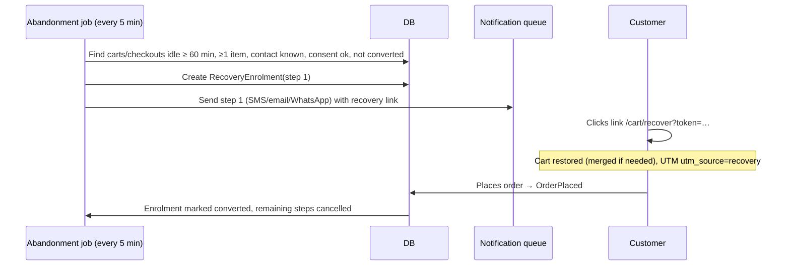

# 06 — SEO & Marketing Integrations

## 1. Summary & goals

Make every product, category and content page discoverable and attractive in search and social shares, and give marketing the tools to win back abandoned carts and measure ad spend — while respecting consent.

**Success metrics**

| Metric                                  | Target                                              |
| --------------------------------------- | --------------------------------------------------- |
| Indexed active product pages            | 100 % within 7 days of publishing                   |
| Rich result eligibility (Product)       | 0 errors in Search Console structured-data report   |
| Organic sessions share                  | Track baseline, +25 % in 6 months                   |
| Abandoned-cart recovery rate            | ≥ 8 % (MVP), ≥ 12 % (Phase 2 multi-step)            |
| Purchase event match rate (Meta/Google) | ≥ 90 % of orders deduplicated across pixel + server |

## 2. Personas

Marketing, Catalog manager (SEO fields), Owner, search-engine and social crawlers, customers receiving recovery messages.

## 3. Sub-features

### 3.1 Customisable meta tags — `MVP`

| ID        | Requirement                                                                                                                                                                                         |
| --------- | --------------------------------------------------------------------------------------------------------------------------------------------------------------------------------------------------- |
| SEO-FR-01 | Every indexable entity (product, category, collection, brand, page, home) has optional overrides: `metaTitle`, `metaDescription`, `ogTitle`, `ogDescription`, `ogImage`, `noindex`, `canonicalUrl`. |
| SEO-FR-02 | Fallback templates configured in settings, e.g. product title: `{name} – {brand} \| Jofak`, description: first 155 chars of plain-text description, OG image: first product image (1200×630 crop).  |
| SEO-FR-03 | Admin editor shows character counters (title ≤ 60, description ≤ 160) and a live Google snippet + WhatsApp/Facebook card preview.                                                                   |
| SEO-FR-04 | Output via Next.js Metadata API (`generateMetadata`) server-side; includes `og:*`, `twitter:card=summary_large_image`, `og:price:amount` / `og:price:currency` for products, `<html lang="en-GH">`. |
| SEO-FR-05 | Canonical URL on every page; PLP filter/sort URLs canonicalise to the unfiltered page and are `noindex,follow` unless whitelisted (SEO-FR-10). Paginated pages are self-canonical.                  |
| SEO-FR-06 | Non-production environments send `X-Robots-Tag: noindex` and a disallow-all robots.txt.                                                                                                             |

### 3.2 Clean URL slugs & redirects — `MVP` (auto-redirect) / `Phase 2` (redirect manager)

| ID        | Requirement                                                                                                                                                                              |
| --------- | ---------------------------------------------------------------------------------------------------------------------------------------------------------------------------------------- |
| SEO-FR-07 | Slugs auto-generated from name: lowercase, ASCII transliteration, hyphens, stop-characters removed, max 80 chars (`Kente Print Midi Dress` → `kente-print-midi-dress`). Editable.        |
| SEO-FR-08 | Slugs unique per entity type; collisions get `-2`, `-3` suffix.                                                                                                                          |
| SEO-FR-09 | Changing a slug (or category path) automatically creates a 301 redirect from the old URL; redirect chains are collapsed (A→B, B→C becomes A→C, B→C).                                     |
| SEO-FR-10 | SEO landing pages: whitelisted filter combinations get their own clean URL, title and copy (e.g. `/c/women/dresses/red` → category dresses + color red) — `Phase 2`.                     |
| SEO-FR-11 | Redirect manager in admin: CRUD, CSV import, hit counts, 404 log with "create redirect" action — `Phase 2`.                                                                              |
| SEO-FR-12 | Archived products: 301 to primary category (default) or 410 Gone (merchant setting).                                                                                                     |
| SEO-FR-13 | URL patterns: `/p/{slug}`, `/c/{parent}/{child}`, `/collections/{slug}`, `/brands/{slug}`, `/pages/{slug}`. Trailing slashes normalised (no trailing slash), lowercase enforced via 301. |

### 3.3 Automatic XML sitemaps & robots.txt — `MVP`

| ID        | Requirement                                                                                                                                                                   |
| --------- | ----------------------------------------------------------------------------------------------------------------------------------------------------------------------------- |
| SEO-FR-14 | `/sitemap.xml` is a sitemap index linking to `/sitemaps/products-{n}.xml` (≤ 10,000 URLs each), `categories.xml`, `collections.xml`, `brands.xml`, `pages.xml`.               |
| SEO-FR-15 | Includes only indexable, active entities; `<lastmod>` = entity `updatedAt` (meaningful content changes only). Product entries include `<image:image>` for the primary images. |
| SEO-FR-16 | Regenerated incrementally on `ProductPublished/Updated/Archived`, `CategoryUpdated`, page changes (debounced 5 min) and fully nightly; served from cache/object storage.      |
| SEO-FR-17 | `robots.txt` allows all public routes, disallows `/cart`, `/checkout`, `/account`, `/admin`, `/api`, search URLs with parameters, and declares the sitemap.                   |
| SEO-FR-18 | Optional ping/submit to Google Search Console via API on sitemap change — `Phase 2`.                                                                                          |

### 3.4 Structured data (JSON-LD) — `MVP`

| Page                  | Schema types                                                                                                                                                                                                                                                                                                                                           |
| --------------------- | ------------------------------------------------------------------------------------------------------------------------------------------------------------------------------------------------------------------------------------------------------------------------------------------------------------------------------------------------------ |
| All                   | `Organization` (name, logo, sameAs social links, contactPoint with WhatsApp/phone), `WebSite` + `SearchAction` (sitelinks search box) on home                                                                                                                                                                                                          |
| Product               | `Product` (name, image[], description, sku, gtin if barcode, brand), `Offer`/`AggregateOffer` (price, priceCurrency `GHS`, availability `InStock`/`OutOfStock`/`PreOrder`, url, priceValidUntil for sales, `shippingDetails` with `OfferShippingDetails` for GH, `hasMerchantReturnPolicy`), `AggregateRating` + `Review` (Phase 2, only real reviews) |
| Category / collection | `BreadcrumbList`, `CollectionPage` + `ItemList` of products on page                                                                                                                                                                                                                                                                                    |
| Product               | `BreadcrumbList` following primary category                                                                                                                                                                                                                                                                                                            |
| FAQ / pages           | `FAQPage` where content is a Q&A list                                                                                                                                                                                                                                                                                                                  |
| Store info            | `LocalBusiness`/`Store` with address, opening hours, geo if pickup locations exist                                                                                                                                                                                                                                                                     |

| ID        | Requirement                                                                                                                                    |
| --------- | ---------------------------------------------------------------------------------------------------------------------------------------------- |
| SEO-FR-19 | JSON-LD generated server-side from the same data as the visible page (no mismatch between markup and content).                                 |
| SEO-FR-20 | Variants: one `Product` with `AggregateOffer` (lowPrice/highPrice) or `ProductGroup` with `hasVariant` — chosen per Google's current guidance. |
| SEO-FR-21 | CI test validates JSON-LD for sample pages against schema.org types (e.g. with a structured-data linter).                                      |

### 3.5 Product feeds — `Phase 2`

Google Merchant Center and Meta Catalog feeds (XML/CSV at `/feeds/google.xml`, `/feeds/meta.csv`) with id (variant SKU), title, description, link, image, price, sale price, availability, brand, GTIN, `item_group_id`, product category, shipping. Regenerated hourly. Enables free Google Shopping listings and dynamic retargeting ads.

### 3.6 Abandoned-cart recovery — `MVP` (1-step) / `Phase 2` (multi-step)

| ID        | Requirement                                                                                                                                                                                                                                                                       |
| --------- | --------------------------------------------------------------------------------------------------------------------------------------------------------------------------------------------------------------------------------------------------------------------------------- |
| SEO-FR-22 | **Eligibility**: cart/checkout with ≥ 1 available item, a known phone or email (from account or checkout contact step), idle ≥ 60 min, no order since, cart value ≥ configurable minimum, not enrolled in the last 7 days.                                                        |
| SEO-FR-23 | **Consent**: email recovery to customers who haven't opted out (soft opt-in for existing customers/checkout contacts, per policy); SMS/WhatsApp only with marketing consent or a channel-specific legal basis confirmed by the business. Every message has opt-out.               |
| SEO-FR-24 | **MVP flow**: 1 message after 1 h via preferred channel; content: items (image, name, price), cart total, "Complete your order" link.                                                                                                                                             |
| SEO-FR-25 | **Phase 2 flow builder**: up to 3 steps, e.g. 1 h (reminder, SMS/WhatsApp) → 24 h (email with social proof/reviews) → 72 h (incentive: unique single-use code, e.g. 5 % or free delivery, expires 48 h). Steps, delays, channels, templates and incentive rules are configurable. |
| SEO-FR-26 | **Recovery link**: signed, single-cart token (valid 14 days) restoring the cart on any device; if items are out of stock, the restored cart shows notices and suggestions.                                                                                                        |
| SEO-FR-27 | **Payment-failed recovery**: when a MoMo payment fails or is abandoned at the prompt, send a quick (10 min) "Having trouble? Retry payment" message with a link to retry the same order before it expires.                                                                        |
| SEO-FR-28 | **Stop conditions**: order placed (by any route), unsubscribe, cart emptied, items all unavailable.                                                                                                                                                                               |
| SEO-FR-29 | **Quiet hours**: no SMS/WhatsApp between 21:00 and 08:00 Accra time; deferred to 08:00.                                                                                                                                                                                           |
| SEO-FR-30 | **Attribution**: orders within 7 days after a recovery click (or 3 days after send without click) are attributed to the enrolment for recovered revenue ([05 §4.5](./05-analytics-reporting.md#45-cart-abandonment-metrics--mvp)).                                                |
| SEO-FR-31 | Frequency cap: max 1 recovery message per customer per 24 h across all flows.                                                                                                                                                                                                     |

Other lifecycle flows using the same engine — `Phase 2`: welcome series, post-purchase review request, back-in-stock, price drop, win-back (no order in 90 days), birthday.

### 3.7 Ad-pixel tracking & conversions APIs — `MVP` (browser pixels) / `Phase 2` (server-side)

| ID        | Requirement                                                                                                                                                                                                                              |
| --------- | ---------------------------------------------------------------------------------------------------------------------------------------------------------------------------------------------------------------------------------------- |
| SEO-FR-32 | Supported: **Meta Pixel**, **Google tag (GA4 + Google Ads conversion)**, **TikTok Pixel** (Phase 2), configured by ID in admin settings — no code changes to add/remove.                                                                 |
| SEO-FR-33 | **Consent banner** (cookie categories: necessary, analytics, marketing). Pixels load only after marketing/analytics consent; Google Consent Mode v2 signals set. Choice stored and changeable from footer link. Default: necessary only. |
| SEO-FR-34 | Standard event mapping from the single internal event stream:                                                                                                                                                                            |

| Internal event        | Meta                   | GA4                 | TikTok                 |
| --------------------- | ---------------------- | ------------------- | ---------------------- |
| `page_viewed`         | `PageView`             | `page_view`         | `Pageview`             |
| `product_viewed`      | `ViewContent`          | `view_item`         | `ViewContent`          |
| `search_performed`    | `Search`               | `search`            | `Search`               |
| `add_to_cart`         | `AddToCart`            | `add_to_cart`       | `AddToCart`            |
| `wishlist_item_added` | `AddToWishlist`        | `add_to_wishlist`   | `AddToWishlist`        |
| `checkout_started`    | `InitiateCheckout`     | `begin_checkout`    | `InitiateCheckout`     |
| `delivery_info_added` | –                      | `add_shipping_info` | –                      |
| `payment_initiated`   | `AddPaymentInfo`       | `add_payment_info`  | `AddPaymentInfo`       |
| `order_placed`        | `Purchase`             | `purchase`          | `CompletePayment`      |
| `CustomerRegistered`  | `CompleteRegistration` | `sign_up`           | `CompleteRegistration` |

| ID        | Requirement                                                                                                                                                                                                                                                                                                                                     |
| --------- | ----------------------------------------------------------------------------------------------------------------------------------------------------------------------------------------------------------------------------------------------------------------------------------------------------------------------------------------------- |
| SEO-FR-35 | Event payloads include `content_ids` (variant SKU matching the catalog feed), value, currency `GHS`, num_items.                                                                                                                                                                                                                                 |
| SEO-FR-36 | `Purchase` fires once per order (dedupe by `eventId = order.id`), from the confirmation page and/or server.                                                                                                                                                                                                                                     |
| SEO-FR-37 | **Server-side** (Phase 2): Meta Conversions API, GA4 Measurement Protocol, TikTok Events API sent from a queue worker on `OrderPlaced` (and checkout events), with hashed (SHA-256) phone/email when consented, `fbp`/`fbc`/`gclid`/`ttclid` captured from cookies/URL at session start. Same `eventId` as the browser event for deduplication. |
| SEO-FR-38 | Pixel/tag scripts loaded via `next/script` with `afterInteractive`/`lazyOnload` so they don't block LCP; total third-party JS budget ≤ 80 KB.                                                                                                                                                                                                   |
| SEO-FR-39 | Debug mode in admin shows the last 50 events sent per destination with status.                                                                                                                                                                                                                                                                  |

### 3.8 UTM & attribution — `MVP`

| ID        | Requirement                                                                                                                                                                |
| --------- | -------------------------------------------------------------------------------------------------------------------------------------------------------------------------- |
| SEO-FR-40 | Capture `utm_*`, `gclid`, `fbclid`, `ttclid` and referrer on session start into a first-party cookie (30 days) and the session record.                                     |
| SEO-FR-41 | Orders store first-touch and last-touch attribution (`source`, `medium`, `campaign`) for reports by channel.                                                               |
| SEO-FR-42 | Shareable links generated by the app (WhatsApp share, recovery, emails) auto-append UTMs (`utm_source=whatsapp`, `utm_medium=share`/`sms`/`email`, `utm_campaign=<flow>`). |

### 3.9 Other marketing tools — `Phase 2` / `Phase 3`

- Newsletter sign-up (footer, popup with exit intent; double opt-in for email) — Phase 2
- Segments/audiences export (RFM from [05](./05-analytics-reporting.md)) to Meta Custom Audiences / CSV — Phase 2
- Broadcast campaigns (email/SMS/WhatsApp) to segments with scheduling and send-time quiet hours — Phase 3
- Referral program — Phase 3 (see [03 §3.11](./03-customer-account.md#311-loyalty--referrals--phase-3))

## 4. Data entities

| Entity                           | Key fields                                                                                                                                                  |
| -------------------------------- | ----------------------------------------------------------------------------------------------------------------------------------------------------------- |
| `SeoMeta` (embedded)             | metaTitle, metaDescription, ogTitle, ogDescription, ogImageUrl, noindex, canonicalUrl                                                                       |
| `Redirect`                       | id, fromPath (unique), toPath, statusCode (301/302/410), source (`auto`/`manual`), hits, lastHitAt                                                          |
| `NotFoundLog`                    | path, hits, lastSeenAt, referrer                                                                                                                            |
| `SitemapFile`                    | name, url, urlCount, generatedAt                                                                                                                            |
| `RecoveryFlow`                   | id, name, type (`abandoned_cart`/`payment_failed`/…), isActive, steps[] {delayMinutes, channel, templateId, incentive{}}                                    |
| `RecoveryEnrolment`              | id, flowId, cartId/checkoutId/orderId, customerId?, contact, currentStep, status (`active`/`converted`/`stopped`/`completed`), enrolledAt, convertedOrderId |
| `RecoveryMessage`                | id, enrolmentId, step, channel, sentAt, deliveredAt, openedAt, clickedAt, couponCode                                                                        |
| `MessageTemplate`                | id, key, channel, subject, body (with variables), locale                                                                                                    |
| `MarketingIntegration`           | id, provider (`meta`/`google`/`tiktok`), config (pixel ID, encrypted API token), enabled, serverSideEnabled                                                 |
| `ConversionDispatch`             | id, provider, eventId, eventName, status, response, attempts                                                                                                |
| `CookieConsent`                  | anonymousId, customerId?, analytics, marketing, version, updatedAt                                                                                          |
| `Attribution` (on Session/Order) | firstTouch{}, lastTouch{}, clickIds{}                                                                                                                       |

## 5. API endpoints

| Method & path                                           | Auth                  | Purpose                              |
| ------------------------------------------------------- | --------------------- | ------------------------------------ |
| `GET /api/seo/resolve?path=`                            | public (web server)   | Resolve redirects / 410 for a path   |
| `GET /api/seo/sitemap-index`                            | public                | Sitemap index data (rendered by web) |
| `GET /api/seo/sitemaps/:name`                           | public                | Sitemap URL list                     |
| `GET /api/feeds/:provider`                              | public                | Product feed (Phase 2)               |
| `GET /api/cart/recover?token=`                          | public (signed token) | Restore cart from recovery link      |
| `POST /api/consent`                                     | public                | Save cookie consent                  |
| `POST /api/newsletter/subscribe`                        | public                | Newsletter (Phase 2)                 |
| `GET/PATCH /api/admin/settings/seo`                     | `settings:write`      | Templates & defaults                 |
| `GET/POST/PATCH/DELETE /api/admin/redirects[/:id]`      | `content:write`       | Redirect manager (Phase 2)           |
| `GET /api/admin/redirects/404s`                         | `content:write`       | 404 log (Phase 2)                    |
| `POST /api/admin/sitemaps/regenerate`                   | `content:write`       | Force regeneration                   |
| `GET/POST/PATCH /api/admin/marketing/flows[/:id]`       | `marketing:write`     | Recovery & lifecycle flows           |
| `GET /api/admin/marketing/enrolments`                   | `marketing:read`      | Enrolments & messages                |
| `GET/PATCH /api/admin/marketing/templates[/:id]`        | `marketing:write`     | Message templates                    |
| `GET/PATCH /api/admin/marketing/integrations/:provider` | `settings:write`      | Pixels & CAPI config                 |
| `GET /api/admin/marketing/integrations/:provider/debug` | `marketing:read`      | Recent dispatches                    |

The Next.js app owns rendering of `/sitemap.xml`, `/sitemaps/*`, `/robots.txt` and metadata (App Router `sitemap.ts`, `robots.ts`, `generateMetadata`), fetching data from these endpoints. Redirects are resolved in Next.js middleware (cached map, refreshed on `RedirectsChanged`).

## 6. Domain events

| Event                 | Emitted when                                                                                                                                 | Consumers                       |
| --------------------- | -------------------------------------------------------------------------------------------------------------------------------------------- | ------------------------------- |
| `CartAbandoned`       | Abandonment job marks a cart                                                                                                                 | Recovery flow engine, analytics |
| `CheckoutAbandoned`   | Checkout idle with stage                                                                                                                     | Recovery flow engine, analytics |
| `RecoveryMessageSent` | Message sent                                                                                                                                 | Analytics                       |
| `RecoveryLinkClicked` | Recovery link opened                                                                                                                         | Attribution, analytics          |
| `CartRecovered`       | Order from enrolled cart                                                                                                                     | Analytics (recovered revenue)   |
| `RedirectsChanged`    | Slug change / manager edits                                                                                                                  | Web middleware cache            |
| `SitemapRegenerated`  | Sitemap rebuilt                                                                                                                              | Search Console ping (Phase 2)   |
| Consumes              | `OrderPlaced`, `PaymentFailed`, `ProductPublished/Updated/Archived`, `CategoryUpdated`, `ConsentChanged`, `CartItemAdded`, `CheckoutStarted` |                                 |

## 7. UI surfaces

- Storefront: consent banner, footer "Cookie settings", `/cart/recover`, newsletter form.
- Admin: `/admin/marketing/recovery`, `/admin/marketing/templates`, `/admin/marketing/integrations`, `/admin/seo` (defaults, redirects, 404s, sitemaps), SEO panel on product/category/page editors.

## 8. Acceptance criteria (MVP)

- **Given** a product with no meta overrides, **when** its PDP is rendered, **then** `<title>` is `"{name} – {brand} | Jofak"`, the description is the first ≤ 160 chars of its description, and OG image is the first image.
- **Given** a catalog manager changes a product slug from `kente-dress` to `kente-print-midi-dress`, **when** a user requests `/p/kente-dress`, **then** they get a 301 to `/p/kente-print-midi-dress`.
- **Given** 12,000 active products, **when** `/sitemap.xml` is requested, **then** it lists two product sitemap files and every active product appears exactly once; archived/draft products do not appear.
- **Given** a PDP for an in-stock product, **when** validated with a structured-data validator, **then** `Product` with `Offer` (price, `GHS`, `InStock`) and `BreadcrumbList` have no errors.
- **Given** a guest entered phone at checkout and left with GHS 300 in cart, **when** 60 minutes pass with no order, **then** one recovery SMS (outside quiet hours) is sent with a working recovery link; **and when** they order via the link, **then** no further messages are sent and the order is attributed to the recovery flow.
- **Given** a visitor declines marketing cookies, **when** they browse and purchase, **then** no Meta/TikTok/Google Ads pixels load and no browser conversion events are sent.
- **Given** a purchase with marketing consent, **when** the confirmation page loads twice, **then** only one `Purchase` event is recorded (same `eventId`).

## 9. Open questions

1. Legal basis for SMS/WhatsApp cart recovery without explicit marketing opt-in — confirm with the business's counsel (Act 843).
2. WhatsApp Business API provider and approved template messages (requires Meta template approval lead time).
3. Which ad platforms are actually used at launch?
4. Does the brand want a cookie banner shown to all visitors or only where legally required?
