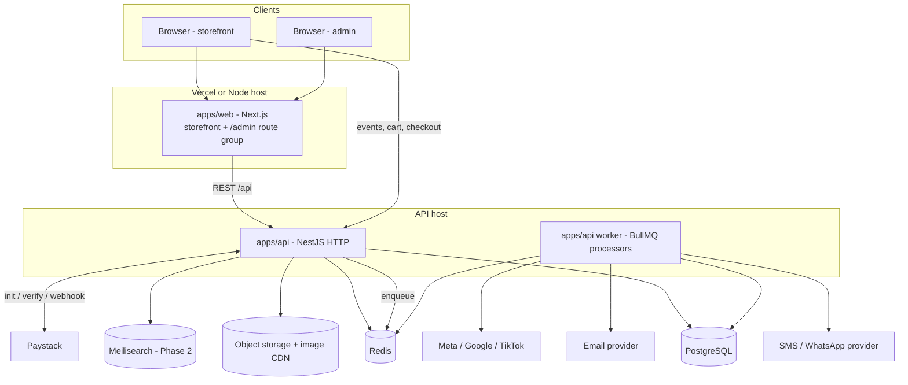

# 07 — Platform & Technical Infrastructure

Cross-cutting technical decisions that every feature relies on. Items marked **(in place)** exist in the codebase today; everything else is a recommendation to confirm when the relevant feature is built.

## 1. Current state

| Area                                   | State                                                                                                                                                                                                                                                                                   |
| -------------------------------------- | --------------------------------------------------------------------------------------------------------------------------------------------------------------------------------------------------------------------------------------------------------------------------------------- |
| Monorepo                               | Turborepo with npm workspaces: `apps/api`, `apps/web`, `packages/ui`, `packages/eslint-config`, `packages/typescript-config` **(in place)**                                                                                                                                             |
| API                                    | NestJS 12, ESM, Express platform; `app.setGlobalPrefix('api')` with `GET /health` excluded; CORS enabled; `cookie-parser`; `ConfigModule.forRoot({ isGlobal: true })`; Swagger at `/docs` with bearer auth; default port `3030` from `PORT` **(in place)** — see `apps/api/src/main.ts` |
| API tooling                            | Vitest (unit + e2e), oxlint, Prettier **(in place)**                                                                                                                                                                                                                                    |
| Web                                    | Next.js 16 (App Router), React 19, `@repo/ui` **(in place)**                                                                                                                                                                                                                            |
| Database, cache, queues, auth, storage | Not yet chosen — recommendations below                                                                                                                                                                                                                                                  |

## 2. Target architecture



**Recommendations**

| Concern                     | Recommendation                                                                                                                               |
| --------------------------- | -------------------------------------------------------------------------------------------------------------------------------------------- |
| Database                    | PostgreSQL 17+ (JSONB for snapshots/attributes, full-text + `pg_trgm`, partitioning for events)                                              |
| ORM / migrations            | Prisma or Drizzle; migrations in `apps/api`, run in CI/CD before deploy                                                                      |
| Cache / locks / rate limits | Redis                                                                                                                                        |
| Jobs & scheduling           | BullMQ (`@nestjs/bullmq`) in a separate worker process from the same codebase                                                                |
| Domain events               | In-process `@nestjs/event-emitter` + **transactional outbox** table relayed to BullMQ for durable, retryable side effects                    |
| File storage                | S3-compatible (AWS S3 / Cloudflare R2) with signed uploads; images via CDN transformer (Cloudflare Images / imgproxy / Next.js Image)        |
| Search                      | PostgreSQL FTS at MVP → Meilisearch/Typesense in Phase 2                                                                                     |
| Admin UI                    | Route group `app/(admin)/admin/*` in `apps/web` at MVP with separate layout and auth; split into `apps/admin` if bundle/deploy concerns grow |
| Shared types                | `packages/contracts` with DTO types / zod schemas, or generate a typed client from the Swagger document (`openapi-typescript`)               |
| Hosting                     | Region close to Ghana users (e.g. AWS `af-south-1` Cape Town or `eu-west` with CDN edge in Lagos/Accra); CDN for static and images           |

## 3. API module layout

Proposed `apps/api/src` structure (one NestJS module per bounded context):

```
src/
  main.ts                     # bootstrap (in place)
  app.module.ts               # root module (in place)
  common/                     # guards, decorators, interceptors, filters, pipes, pagination, money utils
  config/                     # typed config + env validation schema
  database/                   # ORM client, migrations, outbox
  modules/
    auth/                     # customer OTP/password, staff login + TOTP, tokens
    customers/  addresses/
    catalog/                  # products, variants, options, media, categories, collections, brands
    search/
    inventory/                # levels, movements, reservations, counts
    cart/  checkout/  discounts/  delivery/  tax/
    payments/                 # PaymentProvider interface, paystack adapter, webhooks, reconciliation
    orders/  fulfilment/  returns/  refunds/
    reviews/  wishlist/
    content/                  # pages, blocks, menus
    seo/                      # redirects, sitemaps, feeds
    marketing/                # recovery flows, templates, integrations, conversions API
    notifications/            # SMS, WhatsApp, email adapters + templates + log
    analytics/                # event ingest, aggregation jobs, reports
    staff/  audit/  settings/
    health/
```

## 4. API conventions

| ID        | Convention                                                                                                                                                             |
| --------- | ---------------------------------------------------------------------------------------------------------------------------------------------------------------------- |
| PLT-CV-01 | REST + JSON under `/api` (global prefix in place). Admin routes under `/api/admin`. Webhooks under `/api/webhooks/:provider`.                                          |
| PLT-CV-02 | Versioning: URI-less at launch; introduce `/api/v2` only for breaking changes to public clients.                                                                       |
| PLT-CV-03 | DTO validation with `class-validator`/`class-transformer` via global `ValidationPipe({ whitelist: true, forbidNonWhitelisted: true, transform: true })`, or zod pipes. |
| PLT-CV-04 | Error format: `{ "error": { "code": "OUT_OF_STOCK", "message": "…", "details": {…} }, "requestId": "…" }`. Machine-readable `code`s listed per module.                 |
| PLT-CV-05 | Pagination: cursor-based for feeds/lists (`?cursor=&limit=`), offset for admin tables and storefront PLP page numbers; responses include `pageInfo`.                   |
| PLT-CV-06 | Money: integer pesewas in API (`{ "amount": 12000, "currency": "GHS" }`); formatting only in clients.                                                                  |
| PLT-CV-07 | Timestamps: ISO 8601 UTC; business dates in `Africa/Accra`.                                                                                                            |
| PLT-CV-08 | `Idempotency-Key` header required for payment initiation, refunds and order creation; stored 24 h in Redis.                                                            |
| PLT-CV-09 | Every endpoint documented with `@nestjs/swagger` decorators; Swagger UI at `/docs` disabled or auth-protected in production.                                           |
| PLT-CV-10 | `x-request-id` propagated (generated if absent) and included in logs and error responses.                                                                              |

## 5. Authentication & authorisation

| ID        | Requirement                                                                                                                                                          |
| --------- | -------------------------------------------------------------------------------------------------------------------------------------------------------------------- |
| PLT-FR-01 | Two principal types: `customer` and `staff`, with separate token audiences and cookie names; a customer token is never accepted on `/api/admin`.                     |
| PLT-FR-02 | Access JWT (15 min) + rotating refresh token (customer 30 days, staff 12 h) in httpOnly cookies; `Authorization: Bearer` also accepted (Swagger, future mobile app). |
| PLT-FR-03 | Guest identity: signed `cartToken` cookie; guest order access via signed tracking tokens.                                                                            |
| PLT-FR-04 | Staff RBAC enforced by a global guard reading `@RequirePermissions()` metadata ([04 §3.1](./04-admin-catalog-inventory.md#31-staff-roles--permissions-rbac--mvp)).   |
| PLT-FR-05 | CSRF: `SameSite=Lax` cookies + double-submit token for state-changing cookie-authenticated requests from the browser.                                                |
| PLT-FR-06 | CORS restricted to known web origins in production (today `cors: true` — tighten via config).                                                                        |

**Permission list**: `products:read`, `products:write`, `inventory:read`, `inventory:adjust`, `orders:read`, `orders:fulfil`, `orders:cancel`, `orders:refund`, `customers:read`, `customers:write`, `discounts:write`, `content:write`, `marketing:read`, `marketing:write`, `reports:view`, `settings:write`, `staff:manage`.

## 6. Events, jobs & scheduling

| Job                              | Schedule / trigger        | Doc    |
| -------------------------------- | ------------------------- | ------ |
| Outbox relay                     | continuous                | —      |
| Stock reservation expiry         | every 1 min               | 02     |
| Order expiry (unpaid)            | every 5 min               | 02     |
| Payment reconciliation           | every 10 min              | 02     |
| Abandonment detection            | every 5 min               | 05, 06 |
| Recovery flow step dispatcher    | every 1 min               | 06     |
| Sales aggregates                 | every 5 min               | 05     |
| Funnel aggregates                | hourly                    | 05     |
| Customer metrics / cohorts / RFM | nightly 02:00             | 05     |
| Inventory snapshot               | nightly 23:59             | 05     |
| Low-stock digest                 | daily 07:00               | 04     |
| Sitemap full rebuild             | nightly 03:00 + on change | 06     |
| Product feeds                    | hourly (Phase 2)          | 06     |
| Conversions API dispatch         | on event                  | 06     |
| Notification send                | on event, with retries    | 03     |
| Account anonymisation            | daily                     | 03     |
| Search re-index                  | on catalog event          | 01     |

All jobs are idempotent, have retry with exponential backoff, a dead-letter queue and a Bull Board (or similar) admin view protected by staff auth.

## 7. Search

MVP: PostgreSQL `tsvector` column on products (weighted name/SKU/brand/tags/category/description) + `pg_trgm` for fuzzy SKU/name matches; facet counts via aggregate queries on indexed attribute tables. Phase 2: Meilisearch/Typesense index fed by catalog events, giving typo tolerance, synonyms, instant autocomplete and faceting at scale. The `search` module exposes one interface so the backend can be swapped.

## 8. Notifications

`notifications` module with channel adapters behind interfaces: `SmsProvider` (e.g. Hubtel, Arkesel, mNotify), `WhatsAppProvider` (WhatsApp Cloud API or a BSP), `EmailProvider` (e.g. Resend, Postmark, SES). Templates stored per event × channel with variables; every send logged to `NotificationLog` with cost and delivery status (from provider callbacks). Sender ID registered with the SMS provider (e.g. `JOFAK`). Retries on transient failures, fallback channel (WhatsApp → SMS) when undelivered within 5 min for critical messages (OTP, payment).

## 9. Security & compliance

| ID         | Requirement                                                                                                                                                                                                                 |
| ---------- | --------------------------------------------------------------------------------------------------------------------------------------------------------------------------------------------------------------------------- |
| PLT-SEC-01 | Rate limiting (`@nestjs/throttler` + Redis): OTP, login, coupon apply, events ingest, search.                                                                                                                               |
| PLT-SEC-02 | Webhook signature verification for every provider; webhooks endpoint excluded from CSRF and parsed from raw body.                                                                                                           |
| PLT-SEC-03 | Secrets via environment (ConfigModule in place) with schema validation at boot; provider API keys stored in settings are encrypted at rest (AES-256-GCM, key from env/KMS).                                                 |
| PLT-SEC-04 | Helmet security headers; CSP on web (allow-listing pixel domains only when consented).                                                                                                                                      |
| PLT-SEC-05 | PII minimisation: phone/email masked in logs; access to customer PII in admin audit-logged.                                                                                                                                 |
| PLT-SEC-06 | PCI: card data never touches our servers (Paystack hosted/inline) → SAQ A.                                                                                                                                                  |
| PLT-SEC-07 | Ghana Data Protection Act (Act 843): register with the Data Protection Commission as a data controller; consent records; data subject access/deletion ([03 §3.10](./03-customer-account.md#310-privacy--data-rights--mvp)). |
| PLT-SEC-08 | Dependency scanning and `npm audit` in CI; Dependabot/Renovate.                                                                                                                                                             |
| PLT-SEC-09 | Backups: PostgreSQL PITR with daily snapshot, 30-day retention, quarterly restore test.                                                                                                                                     |

## 10. Observability

- Structured JSON logs with `requestId`, `customerId`/`staffId`, route, latency.
- Traces, errors, logs and metrics via **NestJS Observe** (see `apps/api/AGENTS.md`; run `npx @nestjs/observe link` to register `ObserveModule`).
- Business alerts: payment success rate drop, webhook failures, queue backlog, job failures, stock reservation errors, SMS provider failures.
- Uptime checks on `/health` (already excluded from the `/api` prefix) — extend with DB/Redis checks via `@nestjs/terminus`.

## 11. Non-functional requirements

| ID         | Requirement                                                                                                              |
| ---------- | ------------------------------------------------------------------------------------------------------------------------ |
| PLT-NFR-01 | Availability ≥ 99.9 % monthly for storefront and checkout APIs.                                                          |
| PLT-NFR-02 | API latency p95: catalog reads < 200 ms, cart ops < 300 ms, payment initiation < 1.5 s (excl. provider).                 |
| PLT-NFR-03 | Storefront: LCP p75 < 2.5 s on mobile 4G; Lighthouse mobile perf ≥ 85.                                                   |
| PLT-NFR-04 | Capacity: 200 concurrent checkouts and 50 req/s sustained at launch; flash-sale burst 5× with queue-backed side effects. |
| PLT-NFR-05 | RPO ≤ 5 min, RTO ≤ 1 h.                                                                                                  |
| PLT-NFR-06 | Accessibility WCAG 2.1 AA for storefront and checkout.                                                                   |

## 12. Environments, CI/CD & testing

- Environments: `local`, `staging` (Paystack test keys, sandbox SMS, `noindex`), `production`.
- Turborepo tasks (`build`, `lint`, `check-types`, `dev` in `turbo.json`) plus `test` and `test:e2e` for the API; add `test` to the turbo pipeline when web tests exist.
- CI on every PR: lint, type-check, unit tests, API e2e tests against ephemeral Postgres/Redis, build.
- Contract tests for payment webhooks with recorded Paystack payloads; concurrency tests for stock reservation.
- Seed script with realistic Ghana data (zones, regions, sample catalog) for local and staging.

## 13. Configuration (environment variables)

| Variable                                                                | Purpose                             |
| ----------------------------------------------------------------------- | ----------------------------------- |
| `PORT`                                                                  | API port (in place, default 3030)   |
| `NODE_ENV`, `APP_URL`, `WEB_URL`                                        | Environment and canonical URLs      |
| `DATABASE_URL`                                                          | PostgreSQL                          |
| `REDIS_URL`                                                             | Redis                               |
| `JWT_ACCESS_SECRET`, `JWT_REFRESH_SECRET`                               | Token signing                       |
| `ENCRYPTION_KEY`                                                        | Encrypt stored provider credentials |
| `PAYSTACK_SECRET_KEY`, `PAYSTACK_PUBLIC_KEY`                            | Payments                            |
| `SMS_PROVIDER`, `SMS_API_KEY`, `SMS_SENDER_ID`                          | SMS                                 |
| `WHATSAPP_TOKEN`, `WHATSAPP_PHONE_ID`                                   | WhatsApp (Phase 2)                  |
| `EMAIL_PROVIDER_API_KEY`, `EMAIL_FROM`                                  | Email                               |
| `S3_ENDPOINT`, `S3_BUCKET`, `S3_ACCESS_KEY`, `S3_SECRET_KEY`, `CDN_URL` | Media                               |
| `SEARCH_URL`, `SEARCH_API_KEY`                                          | Meilisearch (Phase 2)               |
| `OBSERVE_APP_KEY`, `OBSERVE_APP_SECRET`                                 | NestJS Observe                      |
| `CORS_ORIGINS`                                                          | Allowed origins                     |
