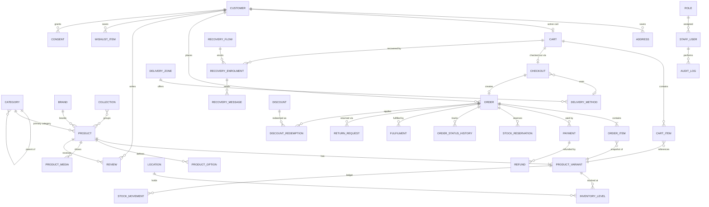

# Appendix — Domain Model

Consolidated view of the entities described in the feature docs. Field lists are in each feature doc's _Data entities_ section; this page shows ownership and relationships.

## Entities by module

| Module          | Entities                                                                                                           | Defined in                                                                                                                                            |
| --------------- | ------------------------------------------------------------------------------------------------------------------ | ----------------------------------------------------------------------------------------------------------------------------------------------------- |
| catalog         | Product, ProductVariant, ProductOption, ProductMedia, Category, Collection, Brand                                  | [01](../01-storefront-discovery.md#4-data-entities), [04](../04-admin-catalog-inventory.md#4-data-entities)                                           |
| inventory       | Location, InventoryLevel, StockMovement, StockReservation, InventorySnapshot, Supplier                             | [04](../04-admin-catalog-inventory.md#4-data-entities), [02](../02-cart-checkout.md#4-data-entities)                                                  |
| content         | ContentBlock, Page, Menu                                                                                           | [01](../01-storefront-discovery.md#4-data-entities), [04](../04-admin-catalog-inventory.md#4-data-entities)                                           |
| cart / checkout | Cart, CartItem, Checkout                                                                                           | [02](../02-cart-checkout.md#4-data-entities)                                                                                                          |
| discounts       | Discount, DiscountRedemption                                                                                       | [02](../02-cart-checkout.md#4-data-entities)                                                                                                          |
| delivery / tax  | DeliveryZone, DeliveryMethod, PickupLocation, TaxComponent                                                         | [02](../02-cart-checkout.md#4-data-entities)                                                                                                          |
| orders          | Order, OrderItem, OrderStatusHistory, OrderNote, Fulfilment, CodRemittance                                         | [02](../02-cart-checkout.md#4-data-entities), [03](../03-customer-account.md#4-data-entities), [04](../04-admin-catalog-inventory.md#4-data-entities) |
| payments        | Payment, PaymentEvent, Refund                                                                                      | [02](../02-cart-checkout.md#4-data-entities), [03](../03-customer-account.md#4-data-entities)                                                         |
| returns         | ReturnRequest                                                                                                      | [03](../03-customer-account.md#4-data-entities)                                                                                                       |
| customers/auth  | Customer, AuthIdentity, OtpChallenge, RefreshToken, Address, Consent, CookieConsent                                | [03](../03-customer-account.md#4-data-entities), [06](../06-seo-marketing.md#4-data-entities)                                                         |
| reviews         | Review, ReviewVote, WishlistItem                                                                                   | [01](../01-storefront-discovery.md#4-data-entities)                                                                                                   |
| staff / audit   | StaffUser, Role, AuditLog, Setting                                                                                 | [04](../04-admin-catalog-inventory.md#4-data-entities)                                                                                                |
| notifications   | MessageTemplate, NotificationLog                                                                                   | [03](../03-customer-account.md#4-data-entities), [06](../06-seo-marketing.md#4-data-entities)                                                         |
| seo             | Redirect, NotFoundLog, SitemapFile (SeoMeta embedded on entities)                                                  | [06](../06-seo-marketing.md#4-data-entities)                                                                                                          |
| marketing       | RecoveryFlow, RecoveryEnrolment, RecoveryMessage, MarketingIntegration, ConversionDispatch                         | [06](../06-seo-marketing.md#4-data-entities)                                                                                                          |
| analytics       | AnalyticsEvent, Session, SearchQueryLog, DailySales, DailyProductStats, FunnelDaily, CustomerMetrics, ReportExport | [05](../05-analytics-reporting.md#6-data-entities)                                                                                                    |

## Core relationships

## Modelling rules

1. **Snapshots over references for history.** Orders copy product name, SKU, options, prices, tax components, addresses and delivery method at placement; later catalog edits never change past orders.
2. **Ledger for stock.** `InventoryLevel` is a cached projection; `StockMovement` is the immutable source of truth. Every write to levels happens in the same transaction as its movement.
3. **Money as integers** (pesewas) with an explicit `currency` column, even though only GHS is used today.
4. **Soft delete** (`deletedAt`) for customer-facing entities referenced by orders (products, variants, categories, customers); hard delete only for unreferenced drafts.
5. **UUID v7** primary keys (time-ordered) for all tables; human-friendly numbers (order `JFK-250001`, return `RMA-…`) as separate unique columns.
6. **Audit columns** on every table: `createdAt`, `updatedAt`, `createdBy`/`updatedBy` where staff-editable.
7. **Phone numbers** stored in E.164; emails lower-cased; both unique per customer where present.
